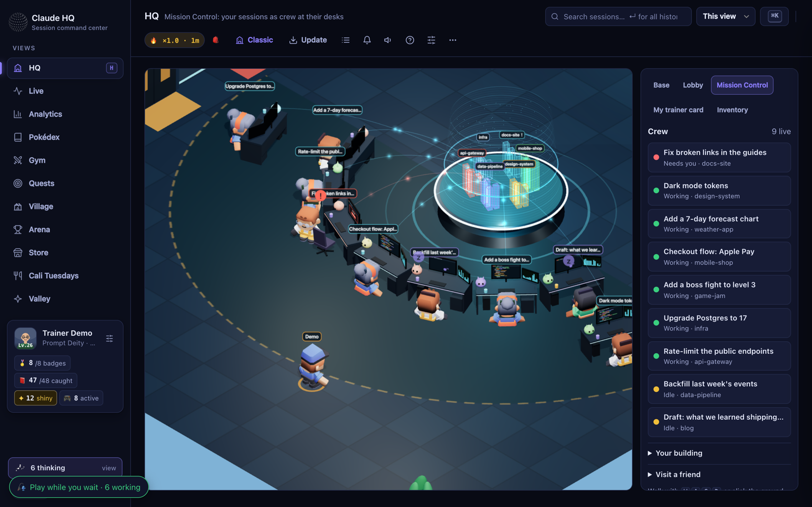
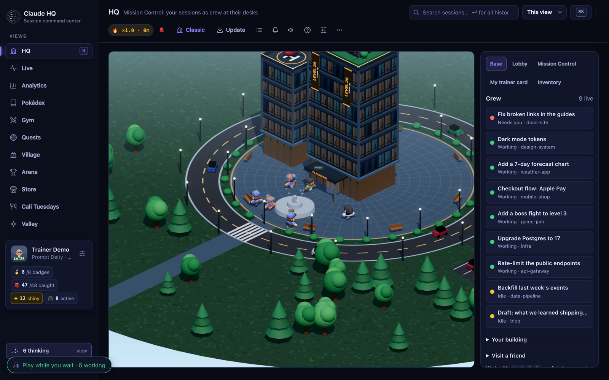
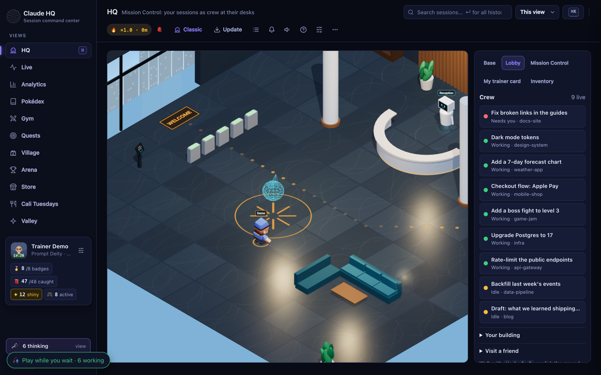
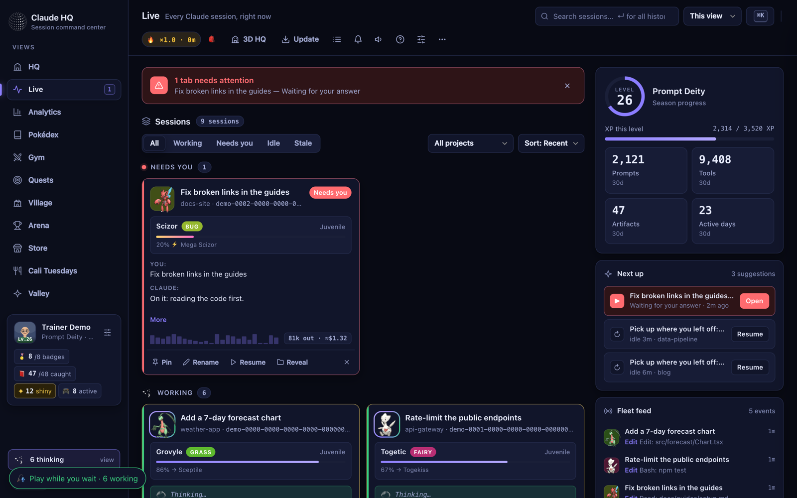
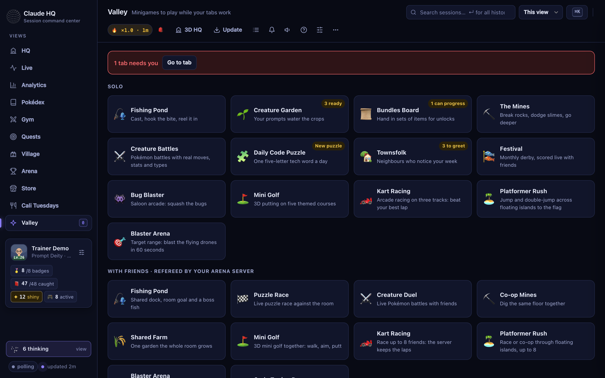
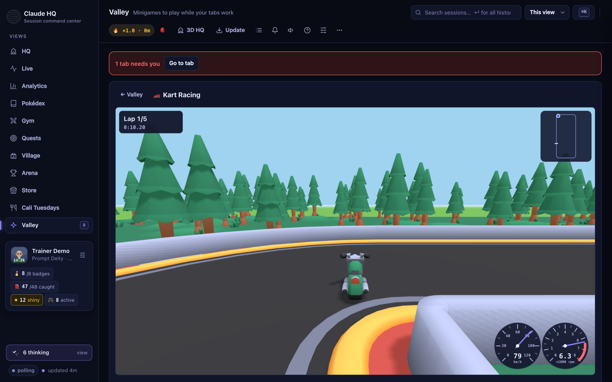
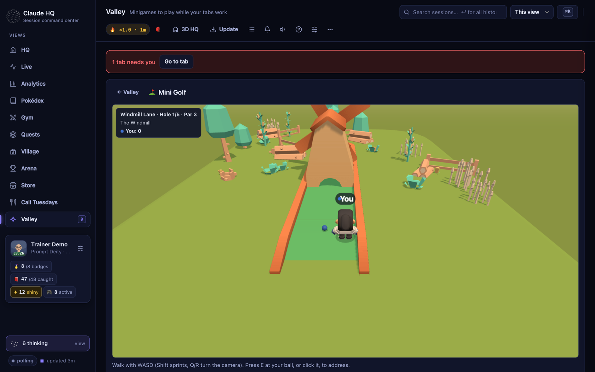

<div align="center">

# ⚡ Claude HQ

**Version 3.14.0** · a **local, private, gamified dashboard** for your Claude Code and Cursor sessions.

Every Claude Code tab becomes a crew member at a desk in your own 3D headquarters.
Walk in, see who needs you, and play with friends while they work.



<sub>Mission Control. Each live session sits at a console: typing while it works, waving when it needs you, dozing when idle. Screenshots use demo sessions.</sub>

</div>

| Walk up to your base | Through reception | Every tab, live |
|:---:|:---:|:---:|
|  |  |  |
| **Base**: your tower grows with your HQ level | **Lobby**: walk in through reception | **Live**: Needs you → Working → Idle |

| The Valley: solo and multiplayer games | Kart Racing with friends | 3D Mini Golf |
|:---:|:---:|:---:|
|  |  |  |

Claude HQ reads your live Claude Code sessions (`claude agents --json`) and the transcripts
already on disk — Claude Code at `~/.claude/projects/**/*.jsonl`, and Cursor agent chats at
`~/.cursor/projects/*/agent-transcripts/*/*.jsonl` — and turns them into a single command center:
what every tab is working on right now, what it would cost at API list prices, a searchable archive
of every past session, and a whole Pokémon-style collection layer on top for fun. A Cursor card's
heading is the chat title Cursor already saved locally, with the first message as a fallback when
that title is missing. Cursor chats have no token totals (Cursor doesn't write them into those
files), so their cost shows as zero. The optional Arena share stays Claude-only.

It runs entirely on your machine and binds to `127.0.0.1` only. **Your conversations never leave your
computer.** (The one exception is that some creature packs load sprite images from a public CDN —
the "pokemon"/"aniimo" packs by creature id, and the "Clash of Clans" pack by troop name + level
number — never any of your data. Switch to the "monsters" pack for 100% offline. The optional [Arena](#-arena-multiplayer--optional) layer, off unless you turn it on,
shares daily activity *counts* with friends — never conversation content. Music (Now Playing, on by default while
paired), published maps and work signals (off by default) add a few listed fields; see [Privacy & security](#-privacy--security) and the changelog.)

---

## 🆕 What's new in 3.1: Travel the archipelago

- **Cities.** The Commons is a shared organic city on its own island, and every player gets an **island
  city** of their own that grows with their XP from Village to Capital, with residents, traffic, buses,
  trams and a city economy.
- **Ferries.** Board a ferry at the dock (E) and sit aboard while it sails down the river, across the sea
  and up the next city's river. The next city loads on the way, with no loading screen. Hold **Space** for 8× speed.
- **Opening bridges.** Bascule, lift and swing bridges open for ferries and taxiing seaplanes while cars
  wait at the barriers.
- **Big ships.** The cruise ship *Claude Serenade* loops round every city, anchoring off its river mouth,
  and container ships run cargo between them. Ride either from a port and go ashore at any stop.
- **Rail.** Build a rail line from your island's station to any other city (500 coins from your city's
  treasury, tier 2+). It runs on viaducts over the streets and across the sea, with 4-car trains you
  can ride. Lines leaving the same station run side by side.
- **Air.** Book a jet between airports, or a seaplane between any two docks. Fly a **helicopter** from the
  pad by your HQ, a hospital roof or the air base: **Space** climbs, **Shift** descends, **W/S** tilt,
  **A/D** turn, **E** gets in or out once landed. Other players see you flying.
- **Fly an airliner (3.6).** A narrow-body airliner and a regional jet in your HQ's livery stand on remote
  stands across the runway at the Commons (the regional jet also beside an island airport's runway at tier 5):
  walk up and press **E**. **W/S** thrust (the jets take a few seconds to spool up), **A/D** steer, then bank,
  **Up/Down** the nose (it lifts off from a runway only, past 202 km/h, 166 km/h for the regional jet),
  **G** gear (assisted: up and down by itself), **F** flaps, **Space** brakes and, in the air, speed brakes
  (the ground spoilers deploy by themselves on landing), **X** assisted/manual, **K** autopilot, **N** go to.
  Land on a runway, taxi back to a stand or the apron, stop, then **E** to get out.
- **Driving feel and convoys (3.12).** Headlights and tail lights come on by themselves at night and in heavy
  rain, storms, snow or fog, with a pool of light on the road ahead (**L** switches them by hand); other players'
  cars light up too. Rain and snow cost grip: longer braking, easier powerslides, motorbikes and bicycles ride more
  carefully, and spray flies off your wheels (the HUD shows **Wet road** or **Snow**). Hit something hard and your
  car dents, a headlight can crack and a wreck smokes (cosmetic only; the garage kiosk, the B1 car lift and the
  dealership repair it). **Convoys:** press **Y** near a friend (or **🚗 Convoy** in Here now) to invite them; they
  press **Y** to join, then hold **J** to keep their slot behind-left or behind-right of the leader, who can set a
  Go to route that every follower sees. **Y** again leaves.
- **The Tuning shop (3.13).** **Redline Tuning**, a workshop next to the dealership in every city from tier 2
  (**Go to → Tuning shop**): walk into its open bay and press **E**, or press **Tune** on a B1 row of the garage
  manager. Paint (factory colours or any colour, gloss / matte / metallic / pearl / chrome, a two-tone roof, stripes
  or a livery), six rim designs per car or bike with their colour and a size step, window tint, a lip, ducktail or GT
  wing, sport / quad / titanium exhausts (bikes: slip-on, under-seat, end can; each changes the engine note) and a
  plate of your own (8 characters; your HQ's name by default). Drag the preview to orbit, the wheel or **+ / −** to
  zoom. Free; your owned vehicles' tunes live in the Arena (others see them), the starters' in this browser.
- **Stunts across every city.** Each city reads its own map and builds a set of giant stunts on its open land
  (**Go to → Stunt**): two **Sky Cannons** that fire you 400-650 m over the rooftops, 100 m+ up and 9-10 s in
  the air through three rings of fire onto a landing ramp; **Big Air** (about 200 m); a **Mega Loop** (26 m
  tall, with a corkscrew); a **River Leap** square across the river; and on an island, a **Sea Launch** out over
  the sea to a splashdown. Drive any car, motorbike or bicycle onto the green boost pad: it sets the exact speed
  that lands the jump (S backs out). In the air **W/S** flip, **A/D** spin, **Shift+A/D** barrel roll; let go
  before you touch down to land square, or bail. Scores count air time, height, distance, tricks and rings, with
  your best kept per stunt. Calm mode turns the pads and flying off.
- **The Commons air base.** Hangars, a radar, an attack helicopter, an aircraft carrier offshore and
  fighter jets flying over.
- **A real airport.** An offshore airfield for the Commons: a 1.6 km runway with full markings and lights,
  taxiways, a terminal and concourse with jet bridges, a control tower, and airliners on a timetable everyone
  shares. Take the **Isle Hopper** from the terminal to an island.
- **Real cars and bikes.** A **dealership** in every city with real vehicles from the brands players pick
  (BMW, Bugatti, KTM so far), grouped in classes by type and engine size, two per class, all free. They drive
  like their real specs, live in a **multi-storey garage**, and drive themselves to you when you press **C**.
- **Find your way.** A minimap (press **M** for the big map), waypoints, and turn-by-turn directions
  along the roads (**N** or **Go to**).

---

## 🆕 What's new in 2.5: Make + compete

- **Workshop.** Build your own **kart tracks**, **Platformer levels** and **Blaster arenas** in editors that
  check them live, test them, then race or play them with friends in a room.
- **Map gallery.** Publish to your room or to everyone; browse newest, most liked and hot this week; like,
  report, remix, "Race in room". Each map keeps its own leaderboard, and a **map of the week** per game.
- **Compete.** A **weekly cup** per game from your normal multiplayer races, a monthly season podium, and a
  **world boss** everyone wears down together with merged PRs and wins, then fights with a Pokémon team.
- **Tower Defense.** Your Pokémon are the towers against twenty bug waves (types matter), solo or co-op.
- **Bowling.** Ten-pin with Pokémon bowlers on the golf physics, solo or up to 8 in a room.
- **Progress from real work.** Loot chests from merged PRs, green test runs and long focus sessions; a
  **skill tree** from how you work; **prestige** stars at level 50; a six-chapter **story campaign**.
  Work signals are off by default and only counts leave your machine.

### Also new since 2.1

- **2.4: your 3D character.** Build the person you are in the 3D HQ (body, colours, hair, headwear,
  accessories, a cyberpunk set) with a live preview; it becomes your portrait on the Trainer card and,
  with the Arena on, on the leaderboard, in rooms and in chat, and friends see your real look in the city.
- **2.3: Arena City.** Jump to City from anywhere, a fountain in the middle and a **bike park** you can ride.
- **2.2: Music.** See what friends are playing (Spotify, Apple Music, YouTube Music), **listening rooms**
  with a shared queue in sync, **Go live** to stream your own audio to the room, and a DJ visualiser.

---

## ✨ Features

**Fleet overview**
- Live cards for every session, grouped **Needs you → Working → Idle → Stale**, updated in real time
  over Server-Sent Events (with a polling fallback).
- **Archived history**: every past transcript shows up as a Stale card — your full history, searchable
  and re-openable.
- Per-card: current in-flight tool, first/latest prompt, last reply, tokens & cost, a 24h sparkline,
  tags, notes, and quick actions.
- **Actions**: ▶ Resume (opens a new terminal into `claude --resume <id>`), 📂 Reveal in Finder,
  ⤢ Focus mode, ✕ Close (stops the process), ✏️ Rename, 📌 Pin.

**Search & detail**
- Full-history **search** across every transcript (TF-IDF ranked).
- Detail **drawer** with a live-tailing timeline, files touched, token/cost, session history
  (started / active days / span), notes & tags, and a **full transcript reader** with in-transcript
  search + Markdown export.

**Analytics**
- 13-week **contribution heatmap** (click any day → that day's digest), token/cost trends,
  busiest-hours & day-of-week charts, **Hall of Fame**, and an **Account & Usage** panel
  (cost by model, cost by project).
- **Project deep-dive**: click any project for its own dashboard.
- **Daily Digest**: a generated "what I did across all sessions today" report (Markdown export).

**Gamification**
- Every session maps (stably) to one of **48 creatures** that **evolve** through real evolution lines
  as the session grows, with elemental **types** and rare **shiny** variants.
- A **Pokédex** collection view, a **⚔️ Gym** team-type-matchup analyzer (real 18-type chart),
  a **🏅 Quests** view, a **Trainer Card**, XP/levels, streaks, achievements, and confetti.
- **⚡ Creature energy**: creatures tire after long unbroken runs (about 2h makes one 💦 Fatigued;
  past 3h it may 💫 faint) and recover while you take a break. With the Arena connected you also
  get **🪙 Poke Coins** (5 a day) to spend in the **🏪 Store** and gift coins or snacks to friends.
  Purely cosmetic: it never touches XP or the leaderboard, rest alone always works, and you can
  turn it off in Settings.
- **🏪 The General Store** (key `8`): a cozy pixel-art shop in the spirit of farm-sim games, all
  original art. 21 foods (fruit, snacks, meals, drinks, sweets and two revives), seasonal stock
  that rotates with the real calendar, a daily special, a shopkeeper who chats (and dozes after
  11pm), a shop cat to pet, and a bag you feed your creatures from.
- **🌮 Cali Tuesdays** (key `9`): a retro pixel-art taqueria for logging Taco Tuesday at
  California Burrito. Seat your friends (type `@` to pick them from the Arena), drag food from the
  counter onto their plates (or click a food, then a plate), watch the receipt work out the pooled buy-1-get-1, then check out to the
  arcade-style hi-score board. Seasons are calendar months; last season's champion gets a crown.

- **🌾 The Valley** (key `0`): ten minigames for the moments a tab is working. A "play while
  you wait" pill appears while tabs work, and the game pauses the moment a tab needs you.
  A pixel-art fishing pond (each project is its own pond; fish modelled on 16 real species with
  real sizes, a hook-and-reel meter and treasure), a garden your prompts water, a bundles
  board, the Mines (deeper on weeks you're active more days), **Pokémon-style Creature Battles** with real species, base stats,
  level-up moves and the 18-type chart, a daily code puzzle, three townsfolk, a monthly
  fishing-derby festival, the Bug Blaster arcade, and **3D Mini Golf** (five themed courses, 25
  holes: windmills, hills, sliding gates, bumpers, sand, ice and water). Battles use a team you
  pick from the Pokémon you've unlocked, or your live sessions. With the Arena connected
  you can also play with friends in your room: a shared fishing dock with a room goal and boss
  fish, a live puzzle race, the live **Creature Duel**, co-op Mines, a shared farm, Mini Golf,
  Kart Racing, **Platformer Rush** (race or co-op across floating islands) and **Blaster Arena** (a
  cartoon first-person free-for-all with lag-compensated shots, plus a solo target range) for up to 8. The server referees every multiplayer game; your own moves show instantly, other
  players are interpolated, and a dropped connection rejoins by itself in about a second. Art is
  drawn in code except the 3D games' CC0 Kenney models and the optional Pokémon sprite pack;
  progress is a local `games-save.json`; in an Arena room only game moves are shared.

- **🔥 Flexible streaks:** a streak survives a quiet day or two. It only breaks when you're inactive on 3 days within any 7 (at least 5 active days in every 7), and today never counts as a miss while it's still going. The Arena leaderboard uses the same rule.
- **🐉 Ride your pets** (3D City): walk up to a grown pet that is out with you and press **E** ("Ride <name>").
  - **Dragons** (all seven, grown): **W / S** faster / slower (S slows to a hover), **A / D** turn and bank,
    **Space** climb (on the ground: leap into the air with big wing beats), **Shift** descend (at speed: a dive),
    let go to glide; **F** breathes its element (fire, frost, lightning, prism, shadow, glitter; off in Calm),
    **N** Go to. Land anywhere flat, including any HQ roof helipad (the landing assist lines you up), then **E**
    gets off (not mid-air: landed or within 3 m of the ground). Cruise 25-45 m/s, a dive to about 57 m/s.
  - **Big dinosaurs** (Triceratops, Brachiosaurus, Stegosaurus, T-Rex, from 400 affection): **W / S** walk,
    **Shift** run, **A / D** turn, **F** roar, **E** off. **Sea serpent** (grown): on the water only, E beside
    the shore to step off.
  - Friends see you riding where the Arena lists `petride` (presence a = 13); elsewhere you show on foot.

**Quality-of-life**
- Command palette (⌘/Ctrl-K), keyboard shortcuts (`?` for help, `1`–`8` for views, `/` search, `r`
  refresh), desktop notifications + optional chime + voice alerts when a tab needs you, a
  **War Room** rotating big-screen view, a **Focus Pomodoro** timer, and a **"welcome back" recap**.
- Settings: **themes** (Aurora / Midnight / Forest / Mono + High-contrast), **creature packs**,
  **accent color**, **large-text** and **calm** (reduced-motion) modes, refresh cadence, stuck-tab
  threshold, and a daily cost budget.
- Accessibility: skip link, ARIA roles/live regions, roving-tabindex grid navigation, focus trapping.

---

## 📦 Requirements

- **macOS** (uses `launchctl` for auto-start, `open`/AppleScript/`kitty` for actions).
- **Rust** (`cargo`, via [rustup](https://rustup.rs)) to build the HQ server once.
- **Claude Code** installed and on your `PATH` (`claude`).
- Optional: [`kitty`](https://sw.kovidgoyal.net/kitty/) terminal (Resume opens a kitty window; falls
  back to Terminal.app).

Two parts do everything: the HQ server in `dashboard-rs/` (`claudehq`, Rust) + the frontend (`index.html` with
its `ui/` files, no JS dependencies or build step).

---

## 🚀 Installation

```bash
git clone <your-repo-url> claude-hq
cd claude-hq
cargo build --release --locked --manifest-path dashboard-rs/Cargo.toml   # about a minute the first time
dashboard-rs/target/release/claudehq
```

That starts the server on <http://127.0.0.1:8765> and opens it in your browser.

> **macOS tip:** clone it **outside** `~/Documents`, `~/Desktop` and `~/Downloads` (for example `~/claude-hq`).
> macOS asks before a new program reads those folders, and every rebuild of `claudehq` counts as a new program,
> so a clone there makes the login item wait on a permission prompt after each update.

### Flags
```
dashboard-rs/target/release/claudehq [--port 8765] [--no-open] [--root DIR]
```

### Run it always-on (auto-start at login)
```bash
dashboard-rs/target/release/claudehq --install     # registers a launchd LaunchAgent (starts at login, self-heals)
dashboard-rs/target/release/claudehq --uninstall   # removes it
dashboard-rs/target/release/claudehq --print-plist # preview the LaunchAgent, no side effects
```
Once installed you never start it by hand again — just open <http://127.0.0.1:8765>.

> **Note:** the LaunchAgent runs the code as it is on disk. Frontend (`index.html`, `ui/`) changes are picked
> up on refresh; after changing `dashboard-rs/`, rebuild (`cargo build --release ...`) and reload it with:
> ```bash
> launchctl kickstart -k gui/$(id -u)/com.claudehq.dashboard
> ```

### Optional shell alias
```bash
echo 'alias claude-hq="$HOME/claude-hq/dashboard-rs/target/release/claudehq"' >> ~/.zshrc   # your clone's path
```

### Optional: HQ Notch (macOS)
Your party in the Mac's notch: each live session as its HQ Pokémon, a live tool ticker, and
**Allow / Always / Deny** for permission prompts plus answers to `AskUserQuestion`, right from the notch.
```bash
python3 notch/tools/install.py      # builds with the Command Line Tools, adds Claude Code hooks (backed up)
```
See [`notch/README.md`](notch/README.md). `--uninstall` removes it all again.

---

## 🔒 Privacy & security

- Binds to **`127.0.0.1` only**; any request with a non-localhost `Host` header is rejected with `403`.
- All state-changing actions (rename / pin / close / resume / settings) require a per-process **CSRF
  token** (injected into the page, sent as `X-HQ-Token`) plus an Origin / `Sec-Fetch-Site` check.
- File lookups are validated (UUID / known-folder allowlists) — no path traversal.
- **Close** only signals a pid that `claude agents` lists as a live interactive session (and whose
  command is still `claude`) — never the dashboard itself or an arbitrary process. If the session
  list cannot be read (e.g. the `claude` CLI is missing), Close is refused with `503`.
- POST bodies are capped at 1 MiB (8 MiB for soundboard uploads); larger requests get `413` (sent
  without reading the body, so a client mid-upload may see a connection reset instead).
- Local state files (`config.json`, `sessions-meta.json`, `evo-choices.json`, `arena-link.json`, `.dex-seed`) are written
  atomically with `0600` permissions. A file that no longer parses is set aside as
  `<name>.corrupt-<timestamp>` (git-ignored) and defaults are used, so nothing is silently overwritten.
  A symlinked state file is written through (the link is kept, the target replaced).
- Your transcripts and settings stay on disk. `config.json` and `sessions-meta.json` are git-ignored.
- **HQ Notch (optional)** talks to Claude Code only through a local Unix socket (`0700` dir, `0600`
  socket, peer uid checked). Its only network requests are HQ's existing sprite hotlinks (a National
  Dex number in the URL) and HQ itself on `127.0.0.1`. If the notch is closed or never answers, every
  hook prints nothing and Claude Code asks in the terminal as usual.
- **Arena is off by default.** When enabled it publishes daily *counts* only — never conversation
  content, file paths or project names — and its device token lives in `arena-link.json`, outside
  `config.json`, so it is never served to the page. See [Arena](#-arena-multiplayer--optional).

---

## 🗂️ Files

| File | What |
|---|---|
| `dashboard-rs/` | The HQ server (`claudehq`, Rust): reads live agents + transcripts, serves the JSON API and the page, and is the Arena client. |
| `index.html` + `ui/` | The frontend: the page template and its CSS and script, split by area in `ui/` and stitched into one page by the server (no build step). |
| `notch/` | Optional macOS notch companion (SwiftUI app + stdlib hook relay + installer). |
| `backend/` | Optional Arena server (Rust). Only needed by whoever hosts it. |
| `arena-link.json` | Your Arena device token. *(git-ignored)* |
| `config.json` | Your settings (theme, pack, budget, …). Created on first save. *(git-ignored)* |
| `sessions-meta.json` | Per-session pins / tags / notes / rename aliases. *(git-ignored)* |
| `meals.json` | Which session ate which snack (local only). *(git-ignored)* |
| `evo-choices.json` | The branch / Mega form you picked per session (local only; `POST /api/evo-choice`). *(git-ignored)* |

### HTTP API (all `127.0.0.1` only)
`GET /` · `GET /api/sessions` · `GET /api/stream` (SSE) · `GET /api/session/<id>` ·
`GET /api/session/<id>/export.md` · `GET /api/transcript/<id>?offset&limit&q` · `GET /api/search?q=` ·
`GET /api/history` · `GET /api/project?folder=` · `GET /api/pokedex` · `GET /api/digest?date&download` ·
`GET /api/config` · `GET /api/meta` · `GET /api/export.{json,csv}` · `GET /api/arena/pantry` ·
`GET /api/arena/cali/board?window={season,30d,7d,all,lastseason}` · `GET /api/arena/cali/orders` ·
`POST /api/action` · `POST /api/config` · `POST /api/meta` · `POST /api/evo-choice` ·
`POST /api/arena/pantry/{claim,buy,eat,give}` · `POST /api/arena/cali/order`
(all POSTs CSRF-guarded).

---

## 🏆 Arena (multiplayer) — optional

Claude HQ is local-first and stays that way. **Arena** is an opt-in layer that
adds a shared leaderboard across you and your friends, a lobby chat and a voice
and video channel with everyone who has Arena open, plus websocket rooms to build
minigames on. It is off until you connect it.

### What is shared

Your dashboard keeps reading transcripts locally and publishes **daily counts
only** — prompts, tool calls, artifacts, tokens. It never sends prompt text,
replies, file paths, project or folder names, session ids, or titles.

- **Tool names are allowlisted.** MCP tools are named `mcp__<server>__<tool>`
  and routinely carry an employer's or client's name, so anything that isn't a
  built-in Claude Code tool is bucketed as `Other` before it reaches the wire.
- **Cost sharing is off by default.** Spend is salary- and employer-adjacent.
- **The skate board is two numbers.** When a combo in Arena City's skatepark beats your
  best for the week, the page sends its total and how many tricks it chained (checked
  by `ext_skate.py`, then by the Arena). Nothing about where, when or from which session.
- **Chat is only what you type.** Messages in the lobby chat go to everyone in
  the lobby, relayed by the server. It keeps the last 50 in memory (never on
  disk) so people who join can catch up; they're gone when the lobby empties or
  the server restarts. The server also cleans and caps messages (500
  characters) and rate-limits them (8 per 10 seconds per connection).
- **Voice and video are peer-to-peer.** Audio and video go straight between
  browsers (WebRTC), never through the server. The server relays only the
  connection setup, which includes IP addresses, and only to the people you're
  in voice with; a public STUN server (Google's) tells your browser its public
  address. Your microphone is used only after you click **Join voice** and your
  camera only after you click **Camera**; both stop when you leave.
- **Live status is off by default.** Turn on **Share my live status** and your
  lobby entry shows how many of your sessions are working and how many are
  waiting on you: just those two numbers, never titles, folders or text.
- **You're in the lobby while HQ is open.** So friends see you online and chat
  and calls reach you on any view. Turn off **Stay in the lobby on every view**
  to show up only while the Arena tab is open.
- **Poke Coins and snacks live on the server**: it sees what you buy, eat or
  give (kind, amount, recipient, an optional note), never which session ate it.
  That stays on this machine, in `meals.json`. Creature energy itself is
  computed locally and is never shared.
- **Valley games send only moves.** In a multiplayer Valley game your browser sends casts,
  reels, puzzle guesses, battle picks, your team as species numbers and species names, golf
  shots and your golfer's position on the course. The server keeps game state in memory (the
  shared farm is stored) and never sees session titles, prompts or project names.
- **Pets are what you chose for them.** With an Arena that has pets, your pets live there: species,
  colours, accessories, affection and the names you typed for them (checked and word-filtered by the
  server). The pets out with you ride in your presence (species, colour, accessory and growth numbers and
  the name, at most two), and visitors to your open HQ see the ones in your lobby. Without one, pets live
  only in this browser. Nothing about your sessions goes into them.
- The wire format rejects unknown fields outright, so a future client change
  can't silently start leaking one.

Scores are computed on the server from raw counts, not submitted by the client,
so the formula can change without a client release.

### Connecting

One person hosts the backend once, on any VPS with Docker and a domain pointed at it:

```bash
sudo ARENA_DOMAIN=arena.example.com bash deploy-vps.sh   # Docker + Caddy (automatic TLS)
```

It asks for your GitHub OAuth app's client id and secret and writes `backend/.env`. Later
releases go through `ops/release.sh deploy` (build, health check, automatic rollback), or the
deploy panel (`ops/install-panel.sh`).

Everyone else just points their own Claude HQ at it: **🏆 Arena → server URL →
Sign in with GitHub → paste the pairing code**. Your device token is stored in
`arena-link.json` (git-ignored) and is never exposed to the page.

Backend source, API and design notes: [`backend/README.md`](backend/README.md).

---

## 🎨 Customization

Open **⚙️ Settings** in the app for themes, creature packs, accent color, text size, calm mode,
refresh rate, stuck threshold, and daily budget. Press **?** in the app for the full keyboard-shortcut
and feature guide.

---

## Changelog

- **3.14.0 — Ride your pets.** A grown dragon (any of the seven), the grown sea serpent or a big dinosaur
  (Triceratops, Brachiosaurus, Stegosaurus, T-Rex, from the grown mark of 400 affection) that is out with you can
  be ridden in the 3D City: beside it, "E  Ride <name>". You sit in a saddle on its back (added when it has none),
  the camera goes to a chase view behind and above, and the pet's own model carries you, big. **Dragons fly**
  (games/hqpetride.js, a slow, agile glider / helicopter hybrid): W / S set the speed it holds (25-45 m/s, S down
  to a hover with fast short beats), A / D turn and bank it, Space climbs with big beats (up to 8 m/s; on the
  ground a leap into the air), Shift descends (from a hover straight down, at speed a dive with the wings folded
  back, up to about 57 m/s), and with neither it glides on spread wings, sinking about 1 m/s. It lands anywhere
  flat, the HQ roof helipads with their landing assist included, and uses the helicopters' floors, ceiling
  (800 m), island-to-island flying on and Go to (N). E gets you off once landed or within 3 m of the ground. F
  breathes the dragon's element forward (fire, frost, lightning, prism, shadow wisps, gold glitter; visual only,
  none in Calm). **Dinosaurs walk** (W / S, Shift runs, their walk and run animations) and the **serpent swims**
  (on the water only). HUD hints, the ride pill and screen-reader tips say how. **Multiplayer:** a new presence
  code a = 13 (riding a pet; the first pet in `pt` is the mount, the height in `h`) behind the new `petride`
  capability; the Arena checks the mount can carry a rider (a grown dragon or serpent, a big dinosaur) and drops
  the frame otherwise. Others draw you on your pet, its wings and gait following your movement. Older Arenas:
  others see you on foot with your pet beside you. **Needs an Arena deploy** for others to see riders. Privacy:
  nothing new leaves the machine (the same pet numbers and name as 3.13's `pt`). Third-party assets: none new.
- **3.13.6 — Players are solid.** Other people in the City (and Mission Control) stop you as a wall does: a
  body on foot or on a board, the box of the bike, motorbike or car they ride or drive (turned their way; a car
  from the dealership at its own size), so you bump off them instead of walking or driving through. Not while they
  fly, nor someone on a floor above or below you. You can't push anyone, and one who walks into you can always be
  walked away from.

- **3.13.5 — Your pets stay with you, your lobby shows them, and the front door goes to the street.** Fixes: E
  in your lobby went to the nearest pet following you (always within 2 m) before any door, lift or ride, so using
  the front door said "Leave <name> here" and your pets were saved as staying home. Now E is a door's, a lift's or a
  ride's whenever one is there, and "Leave <name> here" / "Take <name> out" need you standing still, close (1.5 m to
  leave one, 2.2 m to take one out) and facing it. After a refresh the 3D HQ was often up before the Arena's
  capabilities, so your pets loaded from this browser's empty list and stayed gone (nobody following, nobody in the
  lobby) until you opened the Pets panel; they now load from the Arena as soon as it answers, and your stay-home
  pets appear in the lobby then. Out of your lobby's front door you came out on your roof: the 3.13.4 helideck
  overhangs your front door, and arriving counted as "above everything"; arriving now stands you at the spawn's own
  level (the street, or the deck for the roof lift). Tests: E priority (door before pet), facing and distance, lobby
  pets after a late list, the Arena reload, front gate to the street, lobby door destinations and triggers.

- **Next — Stunts across every city** (`games/hqstunts.js`, tests/test_hqstunts.py). Placed per city from its
  own layout, deterministically (every client builds the same set): a 4 m free-land grid of everything that is not
  road, river, sea, a site, an HQ or a tower district; building lots elsewhere may be cleared (at most 8 a stunt,
  retyped `stunt`, restored when the doc is cached). Two Sky Cannons (the longest 200-640 m flights whose path
  clears every roof by 8 m, at the lowest launch angle that does), Big Air, a Mega Loop, up to three River Leaps
  and a Sea Launch. Each pad gives the exact launch speed; each landing ramp follows its flight just under it and
  meets it at the target, so a touch-down is always along the ramp. Flights are the exact parabola (the same at any
  frame rate). Placement costs 0.1-0.3 s at City load; the stunts draw in 35-41 calls, hidden past 1.1 km.
  Measured headless on the Commons: both cannons 640-680 m, 104-119 m high, 9-10 s, through all three rings;
  Big Air 215 m; River Leaps 102 and 135 m; the loop; a 413 m splashdown.
- **Next — Real revs, real exhausts, smooth multiplayer, call search.** Every catalogue vehicle now carries its
  researched engine (spec.engine: idle, redline, limiter, gear ratios, primary and final drive, rear tyre, voice and an
  exhaust tone of depth / rasp / crackle / induction / whistle), and `games/hqvehiclephys.js engineFor` turns it into
  rpm per m/s for each gear. You drive on the real rpm: the clutch slips to a launch rpm, it upshifts at the redline
  under power (half way up when cruising), downshifts as the revs sag, and stutters on the rev limiter with pops;
  the rev counter reads to that engine's own limiter with its red from the redline. The voices play that rpm with the
  vehicle's own exhaust character (games/engine.js engineProfile(.., real)). Other players are drawn smoothly
  (`games/hqnetsmooth.js`): a buffer of their frames drawn 0.2 s in the past on a curve through them, stamped with
  the sender's own clock and carrying their velocity, yaw rate and revs (the Arena's new `motion` capability; an older
  Arena falls back to arrival times re-timed by distance). Simulated at 30 m/s: the largest frame-to-frame lurch went
  from 487 m/s (and 34 hard snaps in 12 s) to 2.2 m/s. The call list (C) has a search box: brand, model, year, class,
  body or engine. Needs the Arena release for `motion`; works without it.
- **3.13.4 — A real helipad on your HQ, with your helicopter on it.** Every HQ tower's roof now carries a helideck:
  a steel deck raised 3 m over the top roof on legs and struts, cantilevered past it, a 9 m pad (7.5 m on the
  smallest lots: the pad stays over the lot) in its middle with a walkway and a low glass rail round it, so a
  helicopter's rotor fits with room to spare (it was a 2–3.6 m disc). The roof lift's head house, the crown (spire,
  antenna, domes, pagoda, deco, garden), the roof extras, the crew flag and the prestige beam moved out to the
  walkway's diagonals and rim, clear of the pad; the Art Deco parapet is low and under the deck. Your own pad has
  your helicopter parked on it: walk up from the roof lift, E to board, take off; land back and it stays; leave it
  elsewhere and a fresh one stands on your pad again after Return to HQ (T) or five minutes. Friends' pads stay free
  for landing. The landing assist eases the last metres till you are over the middle. Client-only.
- **3.13.3 — Pokémon sprites cached on your machine.** The HQ no longer hotlinks every sprite on every load: the
  page asks the local server (`/api/sprite`), which keeps each Showdown / pkparaiso / PokeAPI sprite in `.sprite-cache/`
  in the HQ folder (gitignored, never committed: the art stays third-party), serves repeats from disk and only goes
  upstream on a miss. Strict allowlist (https, those four sprite libraries, no redirects; anything else is refused),
  images only (gif/png/webp, 2 MB max), upstream 404s remembered for a week, 200 MB cap with oldest-first eviction.
  The fallback chain is unchanged: a miss still ends at the generated monster sprite. Egress is the same sprite URLs
  as before, now sent by the server instead of the browser.
- **3.13.2 — HQ Studio previews live.** The Studio docks right, narrower, with one compact row of tabs, and the 3D view behind it frames what you edit left of the panel. **Exterior**: your actual tower (the City's own `hqtower` code) in a live 3D preview that stays pinned at the top while you scroll; it turns slowly (still in Calm), drag to orbit, wheel to zoom, Day/Night, Hide; every option rebuilds it (debounced) and glides the camera to what changed: the roof for crown and roof extras, the street for entrance, sign, flags and grounds, night for the night light. **Lobby / Floors**: the lobby or Mission Control is framed (you're taken there for now if you're elsewhere) and every click shows on it; close without Save and the saved look and your view come back. **Layout**: placing happens on the floor itself, seen from above: a translucent ghost of the item follows the pointer, green where it fits, red where it would overlap or run off the floor; click places, right-click or Delete removes, R turns, drag pans, scroll zooms; the item picker shows a small picture of each piece; the keyboard cursor still works. Also: the empty pill floating over the lobby (the pets prompt, created before it had anything to say) is gone.
- **3.13.1 — Solid traffic, true shapes; the boombox goes live.** What isn't a box no longer stops you as one:
  the stadium's oval bowl, the cooling tower, stacks and silos block their round outlines (not the square round
  them); you walk between a gantry crane's and the water tower's legs and step into a bus or tram shelter; the air
  base's control tower and radar are round and its parked jets block their own wings and tail, not a 10 x 16 m box;
  the airport car park's ground floor is open between its columns. The City's cars, buses and trams are solid: you hit
  them on foot, on a board and at the wheel (your car bumps off and dents, as off a wall) instead of passing through,
  only at your level (not the street under a bridge or a carpark deck), and they see your car at its size so they
  stop short of it. Live in the Music tab ("🔴 Go live") now puts the boombox on your
  shoulder in the City too, not only a Listen-room song. Anyone near you in the City listens to your live set
  (the same browser-to-browser stream as "🎧 Listen live", started for them when they walk up, louder the closer
  they are, stopped when they walk away). It never cuts over a Listen-room song they're tuned in to, a live set
  they chose in the Music tab, or their own. No new presence field: who is live comes from the room, as before.
- **3.13.0 — Tuning shop, pets and the HQ revamp.** One release, one Arena deploy (migrations 0020, 0021 and 0022;
  presence capabilities `tuning`, `pets` and `hqstyle`).
  - **The Tuning shop.** Redline Tuning, a workshop next to the dealership in every city from tier 2 (Go to → Tuning shop; E at its bay), and Tune on any B1 row of the garage manager. Paint any catalogue or custom colour in gloss, matte, metallic, pearl or chrome, with a two-tone roof, stripes or a livery. Wheels: six rim designs per car or bike, rim colour, and a size step (the tyre's outside never changes). Window tint, a lip, ducktail or GT wing, and sport, quad or titanium exhausts (bikes: slip-on, under-seat, end can) that change the engine note. A number plate of your own (8 characters, filtered; your HQ's name stays the default). Live preview on a turntable under a lift with an orbit camera; B1 plinths and the City show your tuned vehicles. Free. Your owned vehicles' tunes are kept in the Arena (migration 0020, `/v1/vehicles/:id/tuning`) and other players see them through presence `vt` (the new `tuning` capability). Your starters' tunes stay in this browser. Needs the Arena release.
  - **Pets.** Adopt dogs (Shiba, Golden Retriever, Corgi, Husky, Dachshund), cats (Tabby, Siamese, Maine Coon, Black cat), dinosaurs (T-Rex pup, Triceratops, Raptor, Brachiosaurus baby, Stegosaurus), dragons (Wyvern, Fire, Ice, Storm, Crystal, Shadow, Golden) and a Sea serpent at Paws & Claws, the City's new Pet shop (Go to: Pet shop), or from the Pets panel (Cmd-K, Settings). Dogs and cats are free; rarer pets are free from their HQ level or sooner for Poke Coins. Up to 6, two out with you. They follow you round the HQ, B1 and the City, go round buildings, catch up if left behind, idle, nap, hop in your car, fly beside your plane or swim beside your boat. B throws a ball to fetch, U pets, O does a trick (more unlock with affection), and dragons grow. Each dragon has its element: frost breath and snow, fire and embers, lightning, prism sparkles, shadow wisps, gold glitter (off in Calm). The rest live in your HQ lobby, roam, nap and greet you; E takes one out or leaves one there, and visitors to your open HQ see them. Friends see your pets through the new "pets" presence capability (species, colours, accessories, growth and name, at most two). Older Arenas keep pets in this browser only. **Privacy:** pet names you type go to the Arena (checked and word-filtered). Pets look and move like animals: rounded bodies, eyes that blink, jointed legs that walk, trot and gallop, wagging tails, flicking ears, sit and sleep poses, and dragons with folding membrane wings that flap and glide; the Shiba, Husky, Golden Retriever and the dinosaurs use animated low-poly models (the rest stay procedural). **Backend:** migration 0022_pets.sql and /v1/pets/* (deploy needed). **Third-party assets:** CC0 animated models by Quaternius (Ultimate Animated Animals: Shiba Inu, Husky; Animated Dinosaurs: T-Rex, Velociraptor, Triceratops, Stegosaurus, Apatosaurus) in `games/pets/` with `LICENSE-quaternius.txt`, served only from 127.0.0.1.
  - **The HQ revamp and HQ Studio.** Every HQ is grander and a bit bigger, as far as its lot allows: a podium with a grand entrance, setback tiers, six facade systems, lit signage and night lighting, crowns, roof extras and landscaping, and a working helipad on every roof. Land a helicopter on any HQ, get out, walk the roof deck and take the roof lift down; the Lobby has a Roof lift up. HQ Studio (Settings, Cmd-K or the lobby kiosk) styles your tower, a new double-height lobby (reception, centrepiece, seating, art, rugs, signage, ambience), each floor's walls, floor, lighting and furniture, and lets you place decor and pet furniture on a grid. Others see your style when the Arena supports it (migration 0021, "hqstyle"); otherwise it stays on this machine. Privacy: only the style document (enums, colours, grid cells) goes to the Arena, nothing from transcripts. Third-party assets: none. Needs an Arena deploy.
- **3.12.0 — Driving feel + convoys.** Cars, motorbikes and bicycles in the City (`games/hqdrive.js`):
  **lights** switch on at night and in heavy rain, a storm, snow or fog (**L** toggles them by hand), brighter
  lamps and tails plus one additive pool-and-cone mesh on the road (no real lights, one draw call per lit
  vehicle); other players' vehicles light up from your own clock and weather. **Grip:** rain, storms and snow
  lower lateral grip and braking (about −35 % braking in a storm, −50 % in snow; two wheels lose more and ride
  slower), powerslides come easier and last longer, and wet-road spray flies off your wheels (off in Calm); the
  drive HUD shows Wet road / Snow, the lights and the damage. **Damage:** hits above ~22 km/h dent the panels
  you hit, crack a headlight and, past 70 %, smoke from the bonnet (not in Calm); a wrecked car pulls slightly.
  Cosmetic, kept per vehicle in localStorage; the garage kiosk, the B1 car lift and the dealership repair it.
  **Convoys:** **Y** invites the nearest player within 40 m (or **🚗 Convoy** in Here now), **Y** accepts or
  leaves, hold **J** for a soft assist that steers and throttles you into your slot (behind-left / behind-right
  on the road, a wider echelon in the air), a convoy panel lists members, distances and "In formation", and the
  leader's Go to destination is shown to every follower. You leave on a world change or past 300 m. The Arena
  relays it with presence (`ci` / `cv` / `cg`, the new "convoy" capability); older Arenas hide convoys.
  **Privacy / egress:** user ids of the people you invite / follow and your Go to point ride City presence,
  only where the Arena lists "convoy". **Third-party assets:** none. **Backend:** `backend/` changed (deploy needed).
- **3.11.2 — Steady flying on.** Taking off no longer glitches. The Commons' airport sits offshore, past the coast,
  so the moment a plane lifted off the City picked the nearest island whatever your heading, said "Flying on to …"
  and built that island's City (a long frame); a circuit dropped it and picked the next, again and again, and a City
  that came back as another world (an island that isn't available) was swapped in under you mid-air. Flying on is
  now armed only heading for an island (for a plane, also past the airport's runways) for 2 s, announced at most
  once a minute per island, rests 20 s after you turn back, swaps only well past half-way, and never swaps in a
  City built as another world. Landing or getting out disarms it, and a Go to route to a plane ends as you board.
  **Privacy / egress:** none. **Third-party assets:** none.
- **3.11.1 — Bigger plinths, calmer ambience.** B1's gallery turntables grow to 3.45 m (from 3.19 m) so the
  longest catalogue cars as drawn (the 5.8 m i7, the Urus) turn on them with room to spare: seven plinths along
  the back wall and eight down the front, on a 7.25 m pitch, still clear of the lifts, kiosk, lounge, columns and
  chargers (bay i is still slot 3 + i). Thunder is heard only for strikes within 1 km (fading to nothing at the
  edge, no floor) and fireworks only within 1 km of the camera. A new **Ambient sounds** switch in Settings
  (on by default, separate from engines and game sounds) silences thunder, fireworks, the rain's hiss and the
  jets' roar. **Privacy / egress:** none (one local setting, `hq_ambient`). **Third-party assets:** none.
- **3.11.0 — The boombox.** While you are tuned in to your Music room and its song plays, your
  character carries a big cartoon boombox on the right shoulder in the 3D City (toon-shaded and inked,
  squashing on the beat, woofers pumping, notes popping out), the right hand gripping it from the outside.
  Anyone within 28 m hears the same song, in step with yours, louder the closer they are
  (`ui/app/39-boombox.js`). The Arena relays it with presence (`bb` / `bt` / `bn`, the "boombox"
  capability). The HQ chat panel is now always open (no hide button).
  **Privacy / egress:** your room song's YouTube id, start time and title ride your City presence to the
  Arena while it plays; listeners load it in YouTube's privacy-enhanced embed (the main player as a
  fallback), as the Music tab does. **Third-party assets:** none.
- **3.10.1 — Strikezone: the arsenal explains itself.** Each gun on the pre-match card now
  says what it does and how to fire it (keys, scope, the grapple's drone-swing / foe-lock).
  **Privacy / egress:** no new network calls. **Third-party assets:** none.
- **3.10.0 — Wider roads.** Every street in the Commons and on every island is paved wider: a local road 10.5 m
  (a 7 m carriageway, was 5 m; 1.75 m sidewalks), an arterial 15.5 m (11 m, was 8; 2.25 m sidewalks), the Commons'
  highways 13.5 m (were 10) and its ring road 12 m (was 9). Lanes, markings, kerbs and traffic follow the new widths.
  Nothing moves: the city is laid out exactly as before (the same lots, HQ lots and their ranks, sites), and the wider
  road takes the strip of block and lot along it, each lot's door stepping back up to 2 m with its frontage; a civic
  building or stop the wider road would reach steps back by as much. Where a lot cannot give way (a dead end's tip in a
  notch of it, a sharp corner into a junction, an HQ lot that would drop under the pool's least size) the road beside
  it keeps its old width (about 3% of street segments). Arena City (claude-hq@1) is unchanged. Needs an Arena deploy.
- **3.9.0 — Lamborghinis, new bikes and redesigned vehicles.** Thirteen new vehicles in the catalogue (`games/vehicles/catalogue.json`, its
  Arena copy `backend/data/vehicles.json`), each with its maker's real specs, size and factory paints, its own stand-in
  body and engine voice. Every vehicle is free for now, as before.
  - **Lamborghini, a new Supercar type:** `car.super.over5000` (Revuelto: 6.5 L V12 plug-in hybrid, 1015 CV;
    Huracán STO: 5.2 L V10, 640 CV, rwd) and `car.super.5000` (Temerario: 4.0 L twin-turbo V8 hybrid, 920 CV; the
    1974 Countach LP400: 3.9 L V12) are on sale at every dealership. The Urus Performante waits as a `car.suv.5000`
    reserve (both slots are BMWs). A wedge body: the windscreen's foot over the front axle, an engine cover sloping
    to the tail, trapezoid arches, slim Y-signature headlights, hexagonal tail rings, tips and a generic hexagonal
    badge, big side intakes, scissor-door shut lines, louvres on the engine glass, the STO's wing and roof scoop;
    the Urus as an SUV with the same cues and a sharp shoulder crease. New voices: a naturally aspirated V10 (8,700
    rpm) and V12 (9,500 rpm).
  - **Bikes, three new types:** Hypersport (`bike.hypersport.over950`: Kawasaki Ninja H2, Suzuki Hayabusa, on sale),
    Classic (Royal Enfield Classic 350 and Interceptor 650) and Cruiser (Harley-Davidson Fat Boy 114); the Ducati
    Panigale V4 S and Yamaha R1 wait as `bike.sport.over950` reserves and the Triumph Street Triple 765 RS as a
    `bike.naked.950` reserve, and the classic and cruiser classes go on sale once each has a second bike (the
    two-per-class rule) — superseded below: everything is on sale. Each looks like itself: the Panigale's single-sided swingarm, biplane winglets and two
    cans stacked under the seat; the H2's green trellis, chrome-mirror flanks and ram-air duct; the Classic's round
    lamp under its nacelle, teardrop tank, chrome, spoked wheels and sprung saddle; the Interceptor's twin
    peashooters; the Fat Boy's disc wheels, V-twin, floorboards and wide pull-back bars; the Triumph's bug eyes; the
    R1's M1 face; the Hayabusa's long round nose and stacked headlight. Two new rider poses ride on the same seat,
    grip and foot anchors: upright on a classic, and low, feet forward, arms out on a cruiser. Seven new voices: a
    twin-pulse V4, an inline triple, a crossplane four, a supercharged four (its whine, a chirp on a lift), a
    long-stroke single, a 270-degree twin and a 45-degree V-twin.
  - **Every existing stand-in redesigned to look like its model:** car bodies have rounded shoulders and draw in at
    the nose and tail in plan; BMW grilles by model (the M3/M4's tall kidneys with horizontal slats, the 3 Series'
    wide ones, the M5's and the XM/i7's lit outlines, the M2's frameless pair, the X5's XXL, the X3's diagonal slats,
    the i4's closed panel), lights by model (angel eyes, slim lamps with a vertical DRL, the M2's square lamps, the
    XM/i7's split lamps, the X5's hexagonal DRLs), the M cars' power dome and gills, the M4 CSL's ducktail, laser
    tails and gold wheels, wheel spokes by model; Bugatti's three noses (the Chiron's wide horseshoe and LED row, the
    Tourbillon's tall one and LED columns, the Veyron's round one and projectors), the Chiron and Tourbillon spine,
    the Veyron's roof scoops and round tails, and a hypercar roof. Bikes: KTM's 390/990/1390 Duke faces, the RC's
    single lamp, the Adventures' vertical split lamps, the 1390's single-sided swingarm; BMW's F 900 R and S 1000 R
    lamps, the S 1000 RR's asymmetric pair and winglets, the M 1000 RR's stripes, the G 310 GS's asymmetric lamps.
    Sizes, display scale, rider anchors, collision and the detail atlas are unchanged; cars stay at 14 draw calls
    and under 6k triangles, bikes at 8-10 draw calls and under 6k.
  - **Sell them all: a class is on sale with 1 to 4 vehicles** (it took exactly 2). Every new vehicle is buyable:
    the Urus is `car.suv.5000`'s third, the Panigale and R1 `bike.sport.over950`'s third and fourth, the Street
    Triple `bike.naked.950`'s third, and the one-bike classes (Classic 350, Interceptor 650, Fat Boy) and the
    one-car BMW classes (M135, 330Li, M5) are on sale too. The Bugatti Veyron stays a reserve. The Arena checks
    the same rule (`backend/src/vehicles.rs`); the flagship's forecourt is shallower so its hall shows all 42.
  - **Arena:** the catalogue is server data, so the Arena needs a deploy (`ops/release.sh deploy`) before these
    can be bought.

- **3.8.0 — Fly the airliners.** Two airliners you fly yourself: a narrow-body (the airport's 38 m twin-jet) and a regional jet (the same at 0.72), in your HQ's own livery, on remote stands on the seaward side of the Commons' runway near the 36 end (clear of the passenger jets' stands, taxiways, line-up and roll, and of the prop plane's blast pad), and the regional jet beside a tier-5 island airport's runway (its 500 m runway is too short for the narrow-body). Walk up and press E (✈ Fly the airliner); Go to lists them as Airliner (fly it) / Regional airliner (fly it). A heavy flight model in hqplane.js: slow, damped controls, jets that spool up (about 5 s from idle for the narrow-body), a long takeoff roll that lifts off from a runway only, past 202 km/h (166 km/h regional; about 580 m of the Commons' runway), gear on G and by itself when assisted, flaps, Space for the brakes on the ground and speed brakes in the air, ground spoilers on landing, runway landings only, the autopilot (K) and air navigation (N) as the prop plane, a cockpit view from the captain's seat over a glareshield, and a crash puts you back on the stand. Out only stopped at a stand or on the apron. A new `jet` engine voice: a turbofan's spool whine on N1 (it lags the thrust levers as the engines spool) under broadband roar that grows with the thrust. Others see you in it (presence a = 11 / 12) where the Arena lists the new `airliner` capability; elsewhere you show as the prop plane. Needs the Arena backend release for the new codes.
- **3.7.0 — The Lucky Byte: a casino, with games against other players.** Every city from tier 3 gets a casino.
  - **On the street:** a black-glass hall with gold fins under a hotel tower, a marquee of chasing bulbs, the name in
    neon on the roof beside a pair of giant turning dice, a red carpet between brass stanchions and palms. It is in
    **Go to**. Walk through the doors onto the casino floor.
  - **The floor:** a loud casino carpet, chandeliers, a bar with back-lit bottles, two banks of slot machines, roulette,
    two blackjack tables, the dice pit, the Race Book's wall of screens, Plinko, the Lucky Wheel, a Rocket cabinet, the
    Scratch-O-Matic, a giant Coin Toss coin, and the cashier's cage. Dealers wear waistcoats and bow ties; the crowd
    plays the machines. The wheel spins, the Plinko ball drops and the dealer nods when you win.
  - **Eleven games, played with Poke Coins:** buy chips at the cage (10 chips a coin; cash them back the same way, so a
    win too big for your 30-coin wallet stays on the rack, never lost), walk up to a game and press E (or click its
    prompt). Slots, roulette, blackjack (3:2, the dealer stands on 17s, double down), horse racing (six runners with
    live commentary), Plinko, the Lucky Wheel, Rocket (pick your cash-out; it crashes when it crashes), dice, scratch
    cards (scratch with the mouse) and the coin. Every game keeps a few percent; the golden asterisk by the door shows
    the honest odds.
  - **Player against player:** the Duel Table. Post a challenge (high card, a dice duel, a coin duel, or rock paper
    scissors with hidden moves), and anyone in any casino can take it; it is settled on the spot, the winner taking
    the pot less 5%. You hear about it when someone takes yours, wherever you are on the floor.
  - **The house has opinions:** lose and it roasts your luck (never you): near misses, the zero, your horse last, a bust
    at 22, a big bet, a losing streak, a rival who read your rock, each with a picture (a stamp, a falling chart, the
    world's smallest violin, the house's yacht, a flatlining wallet, a tumbleweed) and a sad trombone. Win and it
    complains.
  - **Things to find:** a duck, a door marked Staff Only, a machine out of order since forever, a cat on a bar stool,
    a money tree, a ghost who plays machine 13 at 3:33 a.m., and an old cheat code.
  - *Security:* every outcome is drawn on the Arena (`backend/src/casino.rs`, the OS-seeded thread RNG) before the
    stake is taken, in one transaction with the payout; the page only animates it. New routes `GET /v1/casino/me`,
    `GET /v1/casino/duels`, `POST /v1/casino/{cage,play,blackjack,duel}` (migration 0019: `casino_play`, `casino_hand`,
    `casino_duel`); the HQ server proxies them as `/api/arena/casino/...`, POST + CSRF, with every field checked
    against an allowlist (a game, a bet, a known pick word or a small number, a duel's uuid). Six plays per 2 s at most.
  - *Privacy:* the only new egress is the game, the bet and the pick (and a duel's id) to the paired Arena. Duels show
    each player's display name, as the Arena's other boards do. No transcript data is involved.
  - *Accessibility:* in Calm and with reduced motion the animations are short and nothing flashes or shakes; every
    control is a button with a label, Space or Enter plays, Escape leaves the table.
- **3.6.0 — Skyline Park after dark: fireworks, a dancing fountain and a sixth ride.**
  - **Free for everyone.** Skyline Park no longer charges a day pass: walk straight in, ride everything. The Arena
    stops charging the `park` fare and stops sending a price, so pages from before 3.6 open the gate free too. The
    ticket booth by the gate is a Welcome booth now.
  - **Fireworks.** Every 8 minutes after dark a 90-second show goes up over the park: shells climb on spark
    trails and burst into peonies, tilted rings, golden willows, twinkling chrysanthemums and strobes, ending in a
    finale four times as fast. Each burst flashes and booms, the sound arriving late with distance. It runs on the
    shared clock, so everyone in the city sees the same show, and you can see it from across the city.
  - **The Storm Galleon**, a swinging pirate-style ship (an original design: a red-and-gold hull with shield
    emblems, a compass-star sail, lanterns and a gold scroll at the bow), rocked up past 70° between two A-frames.
    Its benches step up toward bow and stern; you ride the high stern row. It has its own station, like every ride.
  - **A lagoon with a dancing fountain** in the lawn by the gate, under the coaster's low pass: rippling water in a
    stone coping and eleven jets running four choreographed figures, lit in shifting colours by night.
  - **The park lit up.** Rainbow chase lights run down the coaster's rails and climb the drop tower, every bulb
    glows (and reads from afar), and four searchlights sweep the night sky from the gate and the far corners.
  - **Grounds:** blossom and green trees and flower beds wherever the lawn is clear of the rides, the paths and the
    crowd's walks, and a food court of parasol tables strung with lights by the cotton candy.
  - *Fixed:* you no longer stop short of the landmark towers. Each one blocked a circle round itself, metres outside the
    Aurora Spire's lobes, the Beacon Tower's shaft and fins, and the corners of the square towers; now only the
    tower's own outline at the ground blocks you.
  - *Fixed:* the Starswing's chairs had no backs (the line that added them had slipped into a comment), and a long
    ride name ran off its station's sign.
  - *Accessibility:* in Calm and with reduced motion there are no fireworks, the searchlights hold still and the
    fountain stands steady.
  - *Privacy:* no new egress; the show, the fountain and the ride are computed locally from the clock.
- **3.5.8 — Your car lift's gate no longer faces your building.** On a third of the Commons' lots an HQ with its
  wings (level 30 and up) had its car-lift bay right behind a wing with the gate facing the wing's back wall: a car,
  motorbike or bicycle brought up from B1 came out against the building, so you could not take it out, and the bay was
  in the way coming and going. A bay now only stands where there are 8 m clear in front of its gate; where only the
  back of the lot has room, the bay faces away from the building and you ride out to the back. Lots whose bay was fine
  keep it exactly where it was.
- **3.5.7 — Engines that sound like engines.** Every engine note is now built like the real thing (still pure WebAudio, no audio files): its pitch is the firing frequency (rpm/60 × cylinders/2) of the engine it models, with its own harmonic recipe, a detuned twin for body, a half-order sub for the lumpy ones and a waveshaper for grit, behind a low-pass that opens with the revs and the throttle. A KTM 390 thumps as a single, the 1390 lopes as a V-twin, the R 1300 GS burbles as a boxer, the S 1000 RR screams to 14,000 rpm, BMW's turbo fours and sixes and twin-turbo V8s whistle and blow off when you lift, the Bugattis roar (W16) or shriek (V16) and the EVs whine. On the throttle it is louder and brighter, off it softer with crackle on the overrun for the sporty ones (deterministic, not under Calm); upshifts cut for a moment, downshifts blip; a lumpy, uneven idle; intake roar, road rumble with speed and a tyre squeal in a powerslide. Planes get a flat-six with a two-blade prop's buzz. Every engine is one node graph made once (nothing per frame) into a shared compressor, at about the old volume; muted means silent.
- **3.5.6 — Dealership vehicles, the next layer of detail.** Look through a catalogue car's (lighter) glass and you see a cabin: stitched seats with headrests, a glowing instrument cluster and centre screen, the console and a steering wheel with spokes. Headlights get projector lenses and a DRL strip, tail lights become LED light bars, grilles and intakes a honeycomb mesh, and there are generic round badges, lettered tyre sidewalls, quad, twin or centre exhaust tips by type, side skirts, chrome or black window trim, mirror indicators, a fuel flap and lettered plates. Bikes get a full exhaust (headers, collector, end can with cap and mouth), a sprung shock with its reservoir, swingarm pivot and chain adjusters, gear and brake pedals, brake hoses and cables, fork caps, bar-end weights, knee pads, rim tape, a plate hanger and extra trellis tubes. Nearly all of it is one shared canvas texture, so draw calls are unchanged (14 a car, 8-10 a bike); sizes, seats and the rider's fit are exactly as before.
- **3.5.5 — Dealership vehicles at full size, with more detail.** The catalogue's bikes and cars used to look toy-sized
  next to the starters (built at true metres, while the starters are drawn big round the chunky riders). They now share
  one display scale per kind (`HQV.hqVehicleModels.SCALE`: bikes 1.3×, cars 1.08×), so a superbike stands as big as
  the starter motorbike and every car at least as big as the starter hatch, with the real differences kept (an SUV
  still over a hatch). The rider's seat, grips and pegs, the collision box, the wheelbase used on slopes and the chase
  camera's distance follow it; the car park parks long cars nose to the back line, and the dealership's turntables are
  a little roomier. Handling is unchanged. The stand-in bodies also gain the starters' level of detail: round-shouldered
  tyres, alloys with discs and calipers, shut lines, handles, plates, indicators, fog lights, wipers, a roof fin, SUV
  rails and arch cladding, splitters and diffusers on cars; round tyres (wire spokes on the big adventure bikes),
  discs and calipers, chain and sprockets, radiator, fins, a tank stripe, fork legs, grips, levers, a dash, a skid
  plate and winglets on bikes. Each is still built once and shared (14 draw calls a car, 8-10 a bike).
- **3.5.4 — B1 showcase gallery.** Every vehicle in your basement now stands on its own display plinth, not just the
  three starters: fifteen turntables in two rows (eight along the back wall, the starters S1–S3 by the walnut wall,
  then seven down the front), each with a bronze base, a warm spot cone, a halo spilling onto the stone, a slow
  turn (still in Calm) and a placard naming what stands on it from the catalogue. Bay *i* is plinth 3 + *i*, so
  transfers and bay picking are unchanged; locked bays are dim empty plinths reading "Unlocks at level N". The
  plinths are sized at runtime to the largest vehicle (catalogue dims and the built models' bounding boxes) and capped
  so neighbours never touch; every part of every plinth is one instanced mesh, so fifteen cost a constant six draws.
  You get on from any plinth's edge, and the B1 lounge finally has an open doorway (2.4 m, bronze frame) in its glass.
- **3.5.3 — B1 as a lavish showroom.** The basement garage was mostly black; now it is bright and warm (~3000 K): a
  strong warm fill, warm cove strips along every wall-ceiling edge and under a floating oak ceiling panel, scalloped
  wall-washer pools, polished warm-stone floor slabs (seeded canvas) with the bay lines and numbers in dark ink, dark-
  walnut slats behind the showcase plinths with light spilling from under them, brushed-metal trims, smoked-bronze
  lounge glass round a cognac sofa, rug and floor lamp, the HQ sign in warm neon, framed posters of your HQ's own name
  and level, and more plants. Nothing new moves; the washes, halos and posters are one mesh each and the plants now
  merge into the static group.
- **3.5.2 — Arriving in B1 by the car lift.** You used to arrive standing on the lift facing its back wall, and the
  lift's trigger sat just off the pad on the way out, so the first W sent you straight back up to the street. Now you
  (and what you rode) arrive just off the pad facing into the basement, and the trigger is on the pad itself: drive or
  walk back onto the lift to go up. Also: a vehicle driven down the car lift no longer vanishes on arrival (its
  model stayed in the City's scene), and an owned vehicle homed in B1 is redrawn in its bay when you drive it back down.
- **3.5.1 — Drive your starters out of B1.** You can now get on the car, motorbike or bicycle on its showcase
  plinth from the plinth's edge (the plinth kept you further away than you could reach), and riding a starter onto
  the car lift takes it up to the street with you instead of leaving it in the showcase. Return to HQ (T) still puts
  it back on its plinth.
- **3.5.0 — HQ 3.5 — Basement Garage.** Every HQ now sits on a lavish B1 basement garage: the old garage beside
  the tower is a glass **car lift** (drive on and you go down with your car; drive onto the pad down there and you
  come up on the street in it), and a new **B1 lift** in the lobby takes you down on foot. Your starter car,
  motorbike and bicycle live on turntable showcase plinths; your bought vehicles get numbered bays (more as your HQ
  levels up). The **garage manager** (kiosks in B1 and at the common multi-storey) transfers each vehicle between
  your private basement and the common carpark; calling a B1 vehicle (C) brings it up the car lift. Return to HQ (T)
  puts the starters back in B1. Fixes: an owned vehicle's paint (an index), its carpark bay, and its parked spot cleared
  once it is home.
- **3.4.0 — The dealership and the airport.** Real cars and bikes with a dealership and a garage, and a real
  airport for the Commons.
  - **Real vehicles, in classes.** 32 vehicles from the first player's brands: BMW and Bugatti cars, BMW and
    KTM Duke bikes, from the KTM 390 Duke to the Bugatti Tourbillon. Every vehicle sits in a class by type
    (naked, sport, adventure; hatch, sedan, coupe, SUV, hypercar, electric) and engine size in cc (bikes up
    to 400 cc, 401-950 cc, over 950 cc; cars up to 2000 cc, 3000 cc, 5000 cc, over 5000 cc, electric). Each
    class sells two. More brands join as players add theirs (`games/vehicles/catalogue.json`: one entry per
    vehicle).
  - **They drive like the real thing.** Handling comes from each vehicle's real power, weight and drivetrain:
    rear-wheel drive slides, all-wheel drive grips, electric cars pull from standstill on one gear. 0-100 km/h
    lands on the maker's figure (an M3 Competition in 3.9 s, a Chiron Super Sport in 2.4 s). New engine
    voices: single, twin, V-twin, boxer, W16, V16 and electric.
  - **The dealership.** A glass showroom in every city from tier 2 (the flagship on the Commons) with the
    vehicles turning on display. Press E for the panel: both vehicles of each class side by side with their
    real specs and factory paints, a 3-minute **test drive**, and **Get it**. Everything is free and unlocked.
  - **The garage.** A multi-storey garage where your vehicles live, each in its own bay: six levels on the
    Commons, three on an island at tier 5. Open sides let you see the cars, and a helix ramp you can drive up.
  - **Call your vehicle (C).** Pick one and it drives out of its bay, down the ramps and along the roads to
    you, with hazard lights and its ETA on the minimap, and parks at the kerb beside you. Get out and, five
    seconds later, it drives itself back to the garage. Far from a garage it arrives from just out of sight.
  - **Others see your car.** Other players see the real vehicle you are driving, in your paint (HQ presence
    v4, the `vehicles` capability; older clients still see the starter car or motorbike).
  - The vehicles use built-in 3D bodies drawn to each one's real size for now; licensed models will replace
    them (`tools/vehicle_fetch.py`).
  - **A real airport for the Commons.** The old glass box with a runway patch painted across
    it is gone. The Commons now has an offshore airfield on a reclaimed platform west of the coast: a
    1.6 km runway (18/36) with blast pads, piano keys, touchdown-zone and centreline markings, two
    parallel taxiways with rapid exits, edge, centreline, approach and PAPI lights, a rabbit at night,
    windsocks that follow the wind, signs, fences and a sea wall. A landside terminal with a walk-through
    hall and a ramp leads over a skybridge across Ring Road 5 to a glazed concourse with six jet bridges;
    there are a 66 m control tower with a rotating beacon, an approach radar, a fire station, hangars,
    a fuel farm and a multi-storey car park. Airliners in four invented liveries fly a timetable that is
    the same for everyone (push back, taxi, hold, line up, take off; land, leave by a rapid exit, taxi
    in), with tugs, baggage trains, belt loaders, fuel and catering trucks and a follow-me car working
    the stands. From the terminal you can take the **Isle Hopper**, an amphibian, to an island (and
    back from the island's dock); island to island is still a seaplane. The minimap and the big map
    show the airfield, and ships, ferries, the carrier and the air base keep clear of it.
  **Privacy/egress:** the new dashboard proxies (`GET /api/arena/vehicles/mine`, `POST /api/arena/vehicles/buy`
  and `/api/arena/vehicles/<id>/park`) send only a validated vehicle id, paint and position with the paired
  device token. Presence adds the driven vehicle's catalogue id and paint index. Nothing transcript-derived
  is sent.
- **3.3.4 — Strikezone polish: eight slow drones, a wings-style climb, the grapple in-hand.**
  Flight drones go from 4 to **8**, each on its own slow sky lane (still derived from the map
  bounds). Hooking a drone now **eases** you up to its height the way the wings totem rises —
  no more teleport to altitude. The grappling gun is visible in first-person (it was scaled
  too thin to read), and its aim-down-sights matches the launcher's light zoom. The Tab weapon
  wheel highlight is a real pie slice that covers the selected gun (the old four-quadrant
  squares could not tile five weapons). **Privacy / egress:** no new network calls.
  **Third-party assets:** none.

- **3.3.3 — Strikezone: flight drones + the grappling gun.** Four drones cruise the arena on
  fixed sky lanes (derived from the map bounds — no map-file change). Real players also carry a
  fifth gun, the **Grappling gun** (key `5`): zero damage. Hook a drone and you are pulled to its
  height and swing across the map (jump / sprint to let go); hook a foe (player or bot) and drag
  them in — while the hook is on they cannot shoot. 5 hooks per life; ammo crates refill it. Bots
  never carry it. While The Warden lives the hook is mobility only (no foe hooks, no damage to the
  Warden). Snap additive key `"dr"` + `FLAG_HOOK` on the victim's row; the rocket path keeps
  `LAUNCH_W = 3` so the launcher is unchanged. **Privacy / egress:** no new network calls.
  **Third-party assets:** none — the 3D gun is original geometry; drones reuse the existing
  Kenney `enemy-flying` hotlink with the usual `monsterSVG` fallback.
- **3.3.2 — No more camera pumping near buildings.** Riding (or walking) past buildings, the chase camera kept
  zooming in and out: its collision ray clipped corner after corner, pulling in fast and easing out between them.
  Now once it pulls in it keeps that distance for 0.6 s after the last hit before easing back out, so passing a
  row of buildings is one smooth move in and one out.
- **3.3.1 — S walks you toward the camera.** On foot, holding **S** now turns you to face the camera (smoothly,
  without overshooting) and walks you toward it, as in most third-person games; the camera keeps its heading and
  just backs up with you, and keeps holding when you let go. Press **W** (or turn with **A**/**D**) and it swings
  back round behind you. (3.2.2's S spun the camera round with you, so a held S looked just like W.)
- **3.3.0 — Skyline: landmarks, an amusement park and weather.** The cities got a skyline and a day out.
  - **Six landmark towers** stand over the busiest districts, each its own design: **The Helix** (a glass
    tower turning a quarter turn as it rises), **Aurora Spire** (three-lobed setbacks to a long spire),
    **The Lantern** (a glass bullet in a steel diagrid), **Gemini Towers** (twin towers with a skybridge),
    **Beacon Tower** (an observation tower with a glowing sky-deck) and **The Regent** (art deco stone up to
    a lit sunburst crown). Real PBR facades reflect a real sky; by night their windows light up, floodlights
    wash their feet and aviation lights blink on top. Each is in **Go to**.
  - **Skyline Park**, an amusement park on the city's largest clear park block: a neon gate and marquee, a
    ticket booth, lamp-lit paths, string lights, food stalls and five rides — **Comet**, a roller coaster
    with a lift hill, a banked first drop, a vertical loop and airtime hills, ridden **first person**;
    **Skywheel**, a Ferris wheel with 24 gondolas and a chasing rim of lights; **Freefall**, a drop tower
    with a pause at the top over the whole city; the **Carousel**; and **Starswing**, a wave swinger. Walk
    up to a ride and press **E**. Rides run on the shared clock, so everyone sees the same train; residents
    visit the park too.
  - **Stations and kiosks:** every ride boards from its own station: a boarded deck up steps from the path,
    a tiled gable roof on steel posts with a lit eave, the ride's name in neon ringed by bulbs, a brass and
    velvet queue, an operator's booth and planters (the Comet's runs its roof back over the track). Popcorn,
    ice-cream and cotton-candy kiosks and a ticket booth, each with what it sells, giant, on its roof. Paved
    promenades follow the ground.
  - **A crowd:** visitors stroll the promenades, queue at the stations, wait at the kiosks and ride every
    ride, the City's own detailed residents (the animated Kenney characters) near you and its light bodies
    further off, all on the shared clock.
  - **Look around with the mouse:** drag to turn the camera while walking (left or right button), and drag
    on a ride to look around from your seat; it recentres when the ride ends.
  - **A day pass** is a new `park` fare: **10 Poke Coins**, once per UTC day per city, paid into that city's
    treasury. On an Arena that doesn't sell passes yet the gate opens as a free preview.
  - **Weather**: clear skies, overcast, rain, thunderstorms (lightning, thunder after the flash), snow and
    fog, in 15-minute spells eased in over 90 s; the same for everyone in a city. The city stats panel's
    forecast and an announcement say what is coming.
  - **Weather on the ground:** snow settles a little -- a patchy dusting on roads, pavements, grass and roofs that
    builds over a snow spell and melts after -- and rain leaves the streets darker and glossier until they dry.
    Worked out from the same shared forecast, so everyone sees the same.
  - **Faster:** the park and the landmarks merge their pieces by material (about half the draw calls
    looking into the park), and its crowd, bulbs and balloons rest when you are far off.
  - *Accessibility:* in Calm and with reduced motion, rides are watched from the platform instead of ridden
    first person, nothing falls, and there are no lightning flashes, blinking or chasing lights.
  - *Security:* the pass is server-authoritative. `POST /v1/city/:owner/fare {kind:"park"}` debits the
    rider and writes a `park_pass` row (migration 0016) in the same transaction as the ledger entry, so a
    pass always means the coins were paid and a second purchase that day charges nothing.
    `GET /v1/city/:owner` gains the caller's `park: {price, pass}`. The page can't grant itself a pass.
  - *Privacy:* no new egress. The ticket sends `{kind: "park"}` to the existing fare route; weather and
    rides are computed locally from the clock and the world doc.
  - *Third-party assets:* CC0 surface materials from [ambientCG](https://ambientcg.com) (Facade001,
    Facade006, Facade015, Facade018A, MetalPlates006) and a CC0 sky from [Poly Haven](https://polyhaven.com)
    ("Kloofendal 48d Partly Cloudy (Pure Sky)"), plus PavingStones128, WoodFloor043, RoofingTiles012A and
    CorrugatedSteel005 for the park, resampled JPEGs vendored in `games/city/` with `LICENSE-assets.txt`, 4.6 MB, served only from 127.0.0.1 (`.jpg` only; the licence is not served).

- **3.2.2 — S turns you round.** On foot, **S** no longer walks you backwards facing away: it turns you round
  (a smooth half turn that eases in and out and lands without overshooting, toward the side you are already
  turning), and held, walks you back the way you came while the camera swings round behind you. A tap still
  makes a full about-face; **W** cancels it; **A**/**D** during it change where you end up.
- **3.2.1 — The Get out pill stays clear of the route banner.** On the ground with a route set (taxiing a
  plane, or in a car or on a bike), the Get out / Get on pill now sits just under the navigation banner at
  whatever height it is, instead of a fixed 96 px that a two- or three-line banner overlapped.
- **3.2.0 — Planes, air navigation, and in-sync turning.**
  - **Fly a seaplane or a prop plane.** A seaplane is moored down the river from every city's main dock, and a
    small prop plane (an original design) stands by every airport's runway (the Commons always, an island at
    tier 5). Walk up and press E. W / S set the throttle, A / D bank (steer on the ground or the water), the Up /
    Down arrows or a vertical drag raise and lower the nose; past rotation speed Up lifts off. Assisted flying (the
    default) levels the wings and the nose when you let go, keeps you above stall speed and cannot roll over; X
    switches to manual. G gear, F flaps, Space brakes, K autopilot (holds your height and heading, or flies to
    the waypoint). Lift grows with airspeed, a stall drops the nose gently, ground effect cushions the flare. Land
    the seaplane on any water and the prop plane on a runway (or, slowly, on flat ground with the gear down); a
    crash is a bump and you are back at the dock or the stand. The flight HUD has airspeed and altitude dials, a
    readout with heading, throttle, gear and flaps, and a stall warning. Chase and cockpit cameras, gamepad
    support, an engine note. Other players see your plane where the Arena supports it (the new plane presence
    capability, a = 9 / 10; older Arenas show you standing, as for helicopters).
  - **Air navigation.** While you fly (planes and helicopters), Go to (N) lists the runways, the seaplane's
    landing lane off the river mouth, helipads and the other islands; a minimap click sets a free waypoint. The
    route is a straight line on the minimap, the light pillar marks the destination, and the HUD shows an arrow to
    it with its distance, time at your speed and the height to fly. A runway or a landing lane gets its approach:
    rings down a 3° glideslope from the final approach fix, a touchdown marker, and a glideslope indicator on final.
    At a dock in a city with an airport, the travel menu now says flights leave from the airport (N takes you there).
  - **Turning in sync.** On foot the chase camera used to trail a held turn by up to ~60° and park ~23° off once
    you stopped, while the heading-up minimap turned with your facing at once; dragging the camera turned only the
    camera. Now the camera turns with you (no lag, no overshoot), the minimap turns with the camera, walking with a
    dragged camera steers you toward where it looks, and you turn faster (3.6 rad/s) on a smoother spring.
  - **Smoother walking.** Idle, walk and run blend by speed, played at the rate your stride needs; you lean into
    turns and with the pace, turn your head into the turn and shuffle when turning on the spot; other players are
    dead-reckoned between presence updates and animate the same way.
  - **Water and docks.** Boats, ferries and the seaplane float on one water surface that runs on the drawn sea's
    clock (they used to bob out of step with the waves), moored boats ride the swell instead of sitting flat while
    waves pass through them, a ferry no longer sits 0.2 m deep in the river, boarding a moored boat no longer pops,
    the camera no longer dips under the water, and a far chase camera has the depth precision to stop the shore
    flickering. Piers are finished: planks, posts, a safety line, cleats, fenders, ladders and lamps on the head.
- **3.1.1 — City camera and plates.** The chase camera sits higher and further back (the far camera
  higher still), so you see the street around you instead of the ground at your feet. Left-drag now
  turns the camera too (trackpads have no right-drag); a click still walks. On a motorbike or a bicycle
  the camera follows turns more gently and barely tilts with the lean. Every HQ's car and motorbike
  carry the HQ's name on their number plates.
- **3.1.0 — Navigation, rivers and travel.** Finding your way round the cities, and between them.
  - **A river through every city:** from the sea past the plaza to a harbour basin in town. The
    **dock** stands on its bank by the plaza (on a tier-1 island too, with a road to it) and the
    **port** on the basin, so neither is out on the edge of the city any more. Arterials, the ring
    road and the highways cross on bridges; boats sail up the river and under them.
  - **A minimap** in the bottom-right corner: the coast, the river, the roads, the civic buildings,
    HQs, other players and your route. Heading-up or north-up, zoom with the wheel or +/-, click it
    to set a waypoint, open the full map (M) from it; it zooms out as you speed up.
  - **Waypoints and turn-by-turn directions along the roads:** press **N** or **Go to** for a
    searchable list of places (the dock, the port, the town hall, your HQ, the ferry to your island
    or the Commons...), or click the minimap or the ground on the map. A banner shows the next turn,
    the distance and the ETA; chevrons on the road and a light pillar at the destination lead the
    way; it reroutes when you go another way, and says "Press E for the ferry" at the dock.
  - Keys pressed in a stop's, a dock's or the Go to menu no longer reach the dashboard's shortcuts
    (W no longer switches to the Workshop while a menu is open).
  - **Ferries you ride:** scheduled sailings to up to six places, the same timetable on every client.
    You sit aboard (E at the dock) while it sails down the river, out to sea and up the next city's
    river, and that city loads on the way, with no loading screen. Ferries keep right and keep their
    distance; **Space** goes full ahead (8×).
  - **Opening bridges:** bascule, lift and swing bridges (every city has a mix) lift for ferries and
    seaplanes, with lights, barriers and cars waiting.
  - **Cruise and cargo ships:** the 120 m cruise ship *Claude Serenade* loops round every city and the
    95 m container ships run between two to four. Each anchors off a city's river mouth. Ride either from a port
    and go ashore at any stop.
  - **Rail between islands:** from a station (tier 2+), build a line to another city for 500 coins from
    your island's treasury. It runs elevated over the streets and across the sea, with 4-car trains
    every few minutes you can ride. Lines that leave a station along the same streets run side by
    side, each with its own platform.
  - **Air:** jets between airports and seaplanes between docks (every island has one); a flyable
    helicopter at your HQ, hospitals and the Commons air base (hangars, radar, an attack helicopter, an
    aircraft carrier you can land on, fighter jet sorties). Other players see you flying (HQ presence
    `a` = 7/8 on Arenas that list `fly`).
  - **The big map:** M opens the minimap full size with an animation; drag to pan, zoom, click to set a
    waypoint, Esc to close.
  **Privacy/egress:** `GET /api/arena/rail` and `POST /api/arena/rail/build` send only the validated
  destination world id (`to`) with the paired device token. Presence gains a height and a flying
  pose, as before for driving. Nothing transcript-derived is sent.
- **3.0.0 — Cities.** Arena City grows into a world of cities.
  - **The Commons** (`claude-hq@2`) replaces the gridded street for everyone: an organic city on an
    island, with arterial and local streets, districts (old town, downtown, suburbs, office, tech, film
    and more), every open HQ's tower on the lot the Arena assigns it, and civic buildings you can walk
    into: the HQ tabs open from the library, the market, the post office and the rest, and the **town
    hall** opens the **Town Hall** panel (the city's tier, growth, population, treasury, tax, specialty
    and its market).
  - **Your own island** (`user:<you>@2`): a personal city with your HQ next to the town hall. It grows
    with your XP through five tiers (Village, Town, City, Metropolis, Capital): new streets, lots,
    services, buses from tier 2 and trams from tier 4 appear as you climb. Owners don't place
    buildings; you upgrade the city, move coins in and out (10% fee) and choose who may visit:
    everyone in your Arena (the default), your crew only, or nobody. Visitors walk, ride, shop and trade.
  - **Economy:** passive tax into the city treasury, upgrades, a specialty good per city (the one its
    industry zone visibly makes), supply chains, and a market whose prices move every hour inside a band.
  - **People and traffic:** residents who commute, work, lunch and go home on a schedule (press **E**
    on one to hear them), cars, buses, trams and emergency runs. Press **E** at a stop, pick where to
    go, wait for the bus or tram and ride it (2 coins to that city's treasury).
  - **The sea:** the other islands on the horizon; a rowboat and a jet ski at every dock you can
    drive (E), and land on another island's dock. Press **E** at a dock, port, station or airport for
    ferries, trains, planes and fast travel (1 coin; ferries, rail and boats are free); the **My
    island** / **The Commons** button goes straight between your island and the Commons.
  - **Multiplayer:** each world has its own presence room (`city3d:<world id>`, HQ presence v3); an
    Arena without @2 still gets the 3D City on `claude-hq@1`, and `?world=old` still loads the legacy City.
  **Privacy/egress:** the new dashboard proxies (`GET /api/arena/city/:owner`, `/api/arena/market/:owner`,
  `/api/arena/archipelago`, `/api/arena/world/claude-hq@2/assign`; `POST /api/arena/city/:owner/{build,
  transfer,privacy,fare}` and `/api/arena/market/:owner/trade`) send only the regex-validated owner id
  (a user id or `commons`) and bodies rebuilt from allowlisted, value-checked keys, with the paired device
  token, to the configured Arena. `GET /api/arena/world/user:<id>@2` adds the device token because the
  Arena serves an island only to those who may visit it; the fixed worlds still go without one. Nothing
  transcript-derived is sent.
- **2.9.0 — The 3D Arena City.** Arena City is now a 3D city built from the Arena's generated world
  (`claude-hq@1`), with camera modes, a map, and a local dev Arena (`tools/local_arena.sh`);
  `?world=old` still loads the legacy City.
  **Privacy/egress:** `GET /api/arena/world/:id` sends only the fixed, regex-validated world id and the
  page's `If-None-Match` ETag to the configured Arena; no device token, no transcript-derived data.
  **Dev login:** `POST /v1/auth/dev-login` exists only with `ARENA_DEV_LOGIN=1` and a loopback bind.
  **`tools/local_arena.sh`:** `build start` chains; stop the preview with `stop-tmp 8767`; `restore`
  takes an optional port; `pair` refuses a git root that does not ignore `*.prod-bak` (the backups hold
  the production device token); `stop`/`stop-tmp`/`start` only kill our own arena or claudehq binaries.
  The `install-agent` plist holds `ARENA_SECRET_KEY` (written 0600).
- **2.8.3 — Strikezone: every disaster hits, and it hits what you see.** Arena Disasters used to
  play as theatre: Meteor Shower streaked pretty fire while impact rings scattered at random,
  Toxic Fog painted green clouds at map centre while damage re-rolled somewhere else every second,
  and Hurricane only shoved. Now **every one of the 10 disasters has a real impact on every player
  and bot** (damage, knock, pull, or a 1-per-second chip), and **the hazard you see is the hazard
  that hurts you** — toxic clouds, the sinkhole pit, the wind column and impact marks are frozen
  once at start and shared by the 3D painter and the judge (solo and MP). Impact marks are aimed
  at live fighters often enough to connect. Protocol `strike` v9: snap `di` carries the frozen
  seed / cloud centres / pit, `dm` rows carry damage. Hurricane now chips 3 hp/s while it shoves.
  No new network, no new assets.
  Also in this entry: **disaster polish.** Lightning is a hashed zig-zag bolt (core + halo +
  a side fork), not a straight line; standing under a strike hurts more than standing at the
  rim (proximity crush in both judges). Fitting non-HP hits on every body: thunder / meteor /
  shockring blind (white-out veil), quake / toxic / sink / wind slow your step, sand / hurricane /
  EMP scatter every shot, hurricane wild-aim on bots too. MP carries the blind / slow windows on
  the player flags (`FLAG_BLIND` / `FLAG_SLOW`). Local only, no new network, no new assets.
  Also in this entry: **a fall out of the map is no longer an endless free-fall.** A body
  that leaves the arena (kicked out, knocked past the bounds, a floor gap on the Sandbar)
  gets a 10-second void clock, then a parachute back in — player and bot alike. Nothing
  out there can kill you and you can't shoot yourself, so the clock is the way home;
  the HUD counts it down (`Out of bounds — back in 7s`). Solo the client runs it; in MP
  the Arena referee does and emits the same `spawn` drop a respawn uses. Local only.
  Also in this entry: **The Warden.** Halfway to the score limit a giant torso-only boss rises at
  the map centre — heavy arms that slam the ground (ground warning + arm raise first; anything
  under the arm dies) and laser eyes that sweep the arena (warn, then a beam you hide from).
  While it lives **nobody can hurt each other** — players and bots all shoot the Warden, bots
  retarget it automatically, the round clock and team scores freeze, and only the Warden calls
  disasters and drops loot. Three health checkpoints each spill every non-disaster totem plus a
  health pack in a ring around it. Kill it and the match is back to normal. The boss silhouette
  and its hit volumes were first cut at **2.5×** (retuned to 3× in 2.8.4; totem-golem: rubble skirt, fused torso, heavy
  arms, glowing sigil), and the Strikezone welcome card has a **Warden** section that spells out
  every rule above before you drop in. Menu checkbox
  **Summon the Warden** (next to Map view) turns the fight on or off. Local only, no new
  egress, no new third-party assets.
- **2.8.2 — Account standings.** The Arena's **Standings** has a **Players / Accounts** switch next to
  its title. Accounts mode ranks Claude accounts for the chosen window (Season, 30 days, 7 days, All
  time): one row per account with everyone's combined numbers, expandable to each member's own row and
  their share of the account's XP. The account board moves here from the Crew panel. Saving Settings
  with **Account board** changed now publishes at once instead of on the next 5-minute publish. New
  Arena route `GET /v1/accounts/standings?window=`; against an Arena without it, the local HQ builds the
  same table from `/v1/board`, `/v1/accounts` and `/v1/accounts/mine` (GETs it already makes; nothing
  new leaves the machine). Shows only public handles and counts, never the account key.
- **2.8.1 — Arena City driving.** New, detailed car (a hatchback with wheel arches, alloys, a
  glass cabin with seats, dashboard and a turning wheel, brake lights), motorbike (a small street
  bike) and bicycle (spoked wheels, turning cranks), in scale with your character. Riders sit on the
  seat with hands on the bars or wheel and feet on the pegs or pedals, and lean into turns. Hold
  Shift (gamepad B) and steer to powerslide the car (a smaller slide on the motorbike), with skid
  marks and tyre smoke. A small driving HUD (speed and rev dials with the gear, a Powerslide chip, the
  keys) shows while you ride. Fixes: the wrong vehicle after the street rebuilt, a 50 m teleport while
  sitting in the car, other players seated in the bicycle pose, the car clipping through walls and
  being entered through the garage wall, a parked car jumping back to its garage, the garage roof
  hiding you, and character sizes that varied by load order. **Return to HQ** (the button over
  the street, T or Home, the side panel, the command palette) takes you to your front door and puts
  your car, motorbike and bicycle back in the garage; the city no longer keeps sending you to the
  door of the last HQ you visited.
- **2.8.0 — Valley Rally.** Point-to-point off-road stages in a cel-shaded forest, dry hills and snow,
  by day or night: 20 gates per stage with split times against your best, a road-ahead map, and a
  rally HUD (segmented tachometer, gear, big speed, handbrake / clutch / TC lamps). A detailed car
  model: raycast suspension with weight transfer, Pacejka-style tyres on seven surfaces, AWD / RWD /
  FWD with limited-slip diffs, an automatic 6-speed, handbrake turns and power drifts, optional
  countersteer and traction-control assists, keyboard and gamepad. Three original cars (Moraine T4,
  Saltcedar 240R, Pipit Sprint 16), chase / bumper / hood cameras, dust, ruts and mud, a Graphics
  setting (Auto / High / Medium / Low). Solo time trials with your ghost, a daily stage, 3-stage
  rally events, and live room races of up to 8 (ghost cars) refereed by the Rust Arena
  (`backend/src/rally.rs`: gates in order, speed and teleport guards, splits, events, results,
  per-stage leaderboards, Quick Play, the map gallery). In a room only the stage (seed + road and
  gates) and your car's position frames leave the machine.
- **2.7.0 — The Python HQ is gone; the Rust HQ is the only one.** `dashboard.py` and the modules it
  imported (`arena.py`, `music.py`, `worksignals.py`, `ext_*.py`) are removed; `dashboard-rs/` (`claudehq`)
  serves everything, with the same routes and the same data files. **Still on the Python HQ?** After this
  pull it cannot start again, so switch once by hand, in your HQ folder:
  `cargo build --release --locked --manifest-path dashboard-rs/Cargo.toml`, then
  `dashboard-rs/target/release/claudehq --install` and
  `launchctl kickstart -k gui/$(id -u)/com.claudehq.dashboard`. Nothing is lost: it reads the same files.
- **2.6.3 — The account board.** People signed into the same Claude account can share a row on a
  new **Account board** under the crew board: the combined level of everyone on that account
  (scored like a crew), with their handles. Opt-in under Settings › Account board, off by default.
  **Privacy/egress:** when on, the local HQ (`dashboard-rs`) reads only `oauthAccount.accountUuid`
  from `~/.claude.json` (or `$CLAUDE_CONFIG_DIR/.claude.json`), never writes it, and sends
  `sha256("claude-hq:account:v1:" + id)` to the paired Arena (`POST /v1/me/account`, after each
  publish; `""` when off, which unlinks). Email, organisation, names and the id itself never leave
  the machine. The Arena stores only an HMAC of that hash, keyed by its secret, on the device row
  (`backend-rs` migration 0012, one nullable column). Groups need 2 to 20 people with a device seen
  in the last 30 days. The key is self-reported, so anyone who has used that account can join its
  group: it is a social board, not proof of anything.
- **2.6.2 — HQ Notch on the Rust HQ, and an Update that rebuilds it.** The Rust HQ (`dashboard-rs`,
  `claudehq`) now has HQ Notch's routes (`/api/notch/status`, `/api/notch/install`) and evolution
  picks (`/api/evo-choice`, `creature.evo` in `/api/sessions`), so the "New: HQ Notch" dialog and the
  notch's evolution forms work on either HQ. HQ's **Update** on the Rust HQ now rebuilds `claudehq`
  (`cargo build --release --locked`) when `dashboard-rs/` changed, before restarting; a failed build
  keeps the old server running and says what to run. A Rust HQ built before this needs **one** manual
  rebuild (`cargo build --release --manifest-path dashboard-rs/Cargo.toml`, then restart HQ); the
  dialog now detects that case (and a Python HQ that was not restarted after a pull) and shows the
  exact command to copy. The Rust HQ now matches the Python one feature for feature (Overflow Vial,
  archived prompt-less cards, error recovery, the Arena City skate board, Strikezone assets): every
  route is the same and `dashboard-rs/tools/parity.py --frozen-home` finds 194 of 195 checks identical
  (the odd one: a malformed Content-Length gets an empty 400). To switch:
  `cargo build --release --locked --manifest-path dashboard-rs/Cargo.toml`, then
  `dashboard-rs/target/release/claudehq --install` (back to Python: `python3 dashboard.py --install`);
  both read the same data files.
- **2.6.1 — Reopen the HQ Notch dialog.** Closed the "New: HQ Notch" dialog without reading it? Open it
  again any time from **Settings > HQ Notch** or the command palette (Cmd-K, "HQ Notch"). When the notch
  is already installed it says so and offers **Reinstall**. Closing a reopened dialog keeps your earlier choice.
- **2.6.0 — Get HQ Notch from HQ.** The next time you open HQ on a Mac without HQ Notch, it asks once:
  **Install now** (HQ runs `notch/tools/install.py` for you; it needs the Xcode Command Line Tools), copy the
  command, ask again in 3 days, or never. Local only: `GET /api/notch/status`, `POST /api/notch/install`
  (CSRF-protected), `ext_notch.py`.
- **Unreleased — Strikezone (maps, totems, disasters).** Prior Strikezone waves, folded into one
  entry (they were never separate HQ versions, and their old "2.5.x–2.9.0" labels collided with
  real HQ releases):
  - **Harbor Dockyard 2× + scattered drops.** The yard is twice as big on each edge (84×60 floor)
    with the same container / crate / catwalk / step sizes and full north/south and east/west
    symmetry. **No drop has a fixed pad:** every health kit, ammo pack and totem lands on a fresh
    open ground spot across the arena bounds, and a returning pack re-rolls its spot too.
  - **Dune Compound.** A second arena: an indoor desert compound of sealed adobe rooms and
    passages. The host (and the solo menu) picks the map before a match. Harbor Dockyard is
    unchanged. Bots walk the room/passage graph. The kill feed shows the weapon (smg / marksman /
    revolver / launcher).
  - **Climbable high grounds + 3D bot nav.** Dockyard edges, midfield lookouts, warehouse roof and
    container tops are reachable via real non-overlapping stairs; bots walk those stairs and
    facing spawn pairs sit in known lanes 20–32 m apart so a filled 2v2 opens fire.
  - **Wave C warzone.** 28 new totems (Rift, Mirror Army, Gravity Flip, Time Rewind, Shockwave,
    Bullet Magnet, Chain Lightning, Trapmaster, Hunter's Mark, Blink Dash, Bubble Fortress, Wall
    Runner, Second Wind, Fake Death, Ghost Bullets, Cluster Shot, Overclock, Ricochet, Infinite
    Chamber, Body Swap, Rally, Meteor Call, Chaos Core, Phoenix, Pocket Universe, Fate Splitter,
    Kingmaker, Radar Jammer) plus five drop mechanics (Hot Drop, Totem Fusion, Cursed Drop, Arena
    Events, Contested Capture) and a small top-down radar. Protocol `strike` → 6.
  - **Wave D: Arena Disasters.** Ten arena-wide Disaster totems — Sandstorm, Meteor Shower,
    Hurricane, Thunder Apocalypse, Earthquake, Shockwave Apocalypse, Toxic Fog, Absolute Zero,
    Sinkhole, EMP Apocalypse. Warn (2 s banner) → impact/hold → clear. A solid roof overhead
    stops Meteor Shower and Thunder Apocalypse; any live shield makes you immune to every
    disaster. Environment kills name the disaster in the feed. Three open-air sheds on the Dune
    Compound give real roof cover on both arenas.
  - **Wave E: Disaster totems on their own ring, and a top-bar auto-disaster clock.** Disaster
    totems land on their own drop ring (2 recycled slots) on their own clock (first at 12 s,
    then every 16 s). The auto-disaster clock starts at 30 s and repeats every 45 s, counted
    down in the top bar. Protocol `strike` → 8 (`di` grew a 5th field: ms until the next
    automatic disaster).
  - **Wave F: every disaster is a map-wide event.** The 3D layer paints big, obvious world
    spectacle for all 10 disasters (dust wall, fireballs, walking hurricane column, lightning +
    full-map flash, earthquake shake, expanding shockwave ring, rolling toxic clouds, Absolute
    Zero snow / frost / ice shards, sinkhole pit with debris, EMP blackout). Impact marks paint
    as 3D ground warning rings; `V.booms` render as blasts; the hold banner names what is
    happening. The 2D map fallback washes and rings the same events. Calm / reduced-motion keeps
    the colour and stills the motion. Also fixed: the auto-disaster / Disaster-totem kind roll
    actually varies (`disKind`/`dis_kind` mix the hash now, JS and Rust twins); Disaster totems
    are pickable; and ground drops are reachable from Wave B high grounds.
  - **Wave G: every disaster is visual AND impact, and the two "nothing happened" totems are on
    screen.** Sandstorm / Absolute Zero / EMP chip once a second (3 / 4 / 2 hp). Sandstorm is
    denser. The Rift totem paints two violet openings plus a link beam; the Shockwave totem
    paints an expanding ground ring. Hurricane shoves solo bots too. The game-info card explains
    what each of the 10 disasters does.
  **Privacy / egress:** still zero transcript data off-box; no new network call — all disaster
  theatre is local three.js primitives and generated canvas textures.
  **Third-party assets:** none; every effect is original three.js geometry / materials and
  canvas gradients drawn in code.
- **Unreleased — the Overflow Vial.** A creature that is already Apex keeps earning past
  70 prompts, and HQ now banks half of that surplus (5 XP per prompt) into a shared local ledger
  (`vial.json`, 0600). Each drop dies 24 h after it lands, spends eat the soonest-to-die drop
  first, and one spend lifts a species a single stage — Egg→Hatchling 30 XP, Hatchling→Adult 90,
  Adult→Prime 180, Prime→Apex 400 — from a Village troop card or a caught Pokédex card (a caught
  species can be lifted even with no live session). The Village Vial chip shows a live countdown
  to the next expiring drop and opens a breakdown: lifetime poured per Apex creature and every
  live drop with its own fuse; a fully evolved session's drawer shows what it poured. The stage
  floor itself is the existing New Game+ `DEX_MAX` high-water, so the effect stays purely local;
  the ledger only mutates locally and never leaves the machine. Army Camp now lists every troop
  instead of the top 30 by power so a 0/1-prompt creature isn't scrolled out of reach, and
  payload sessions with zero prompts are no longer dropped (a creature you see in the Pokédex is
  always reachable to lift).

- **2.6.0 — Arena City garages and a skatepark.** Every HQ has a garage in its own colours with a
  drivable car, a motorbike and a bicycle (E; motor vehicles have an accelerator and a handbrake). The
  plaza has a skatepark: two quarter pipes, a fun box, a ledge and a rail, a row of boards to step on,
  ollies, airs, 180/360/540 spins, kickflips, shove-its, grinds, bails and combos with your best kept on
  this machine. Others in the Arena see you skate and your tricks (presence `a = 4` with a trick `k` and a
  height `y`, behind the new `"skate"` capability; the Rust Arena stores and relays them). Others also see
  your car or motorbike (`a = 5` / `6`, the `"drive"` capability), skaters bend, tuck and throw their arms out
  on tricks, and a weekly **Skate board** lists the best combos (only the combo's total and trick count are sent).

- **2.6.0** — **HQ Notch** (`notch/`, macOS, optional). A notch companion app: every live Claude
  Code session as its HQ Pokémon (same species, evolution and shiny as the dashboard), animated by state
  (working, needs you, done, error, idle), with HQ's session titles, the current tool and a live ticker
  with `+N −M` for edits. Permission prompts open the notch with **Allow / Always / Deny / Terminal**,
  and `AskUserQuestion` choices (single or multi-select) can be answered there. Click a card to focus
  its kitty / Terminal / iTerm2 / tmux window. Installed with `python3 notch/tools/install.py`, which
  adds Claude Code hooks (only its own entries, with a settings backup) and a login item.
  *Privacy:* local Unix socket only; no new egress beyond HQ's existing sprite hotlinks.
  Questions are caught by a dedicated `AskUserQuestion` pre-tool hook as well as the permission
  hook, without being asked twice (re-run the installer to add it).
  Notch creatures follow HQ's evolution floor (each species' highest stage from the Pokédex), so a
  new session of an evolved species shows its evolved form; the notch opens after a 0.5 s hover.
  A settings view in the notch (gear icon): **2D / 3D / Match HQ** sprites (3D shows Mega forms at Apex),
  sounds, idle sessions and notch approvals.
  Plan cards (approve or keep planning from the notch), a diff view for each edit in the ticker, and
  opt-in **phone alerts** via ntfy (fixed, content-free text only; see `notch/README.md`, Privacy).
  Branch and Mega picks (Eevee's form, Charizard X / Y) are kept by HQ itself (`evo-choices.json`, local
  only) and sent as `creature.evo`, so the notch and every browser show the form you picked.

- **2.5.1** — **Strikezone.** A new team shooter in the Arena (Valley, game `strike`), separate from
  Blaster Arena (which is untouched):
  - **Teams, not free-for-all**: amber vs cyan. Before a match the host picks the side size
    (2 vs 2, 3 vs 3 or 4 vs 4); when a side is short of players the Arena server fills it with
    **bots** that patrol the dock, chase, aim with human-like error and shoot — they retire as
    humans join. Team-mates can't hit each other; the team score is any member's kill.
  - **A new map — Harbor Dockyard**: tight container lanes, a central warehouse with a doorway
    chokepoint, catwalks along the walls reached by step-chains, crates and health/ammo pickups.
    Not an open field: three lanes, rotation-friendly.
  - **Same proven netcode** as Blaster Arena (client prediction, 20 Hz server tick, lag-compensated
    shots), plus: `~` (or right-click / LT) **scopes in** — camera zoom with a steadier sight, no
    spread change (nothing desyncs); a graphics quality switch (Classic / Balanced / Ultra) with
    PBR materials, soft shadows, tone mapping, a gradient sky and glowing container-edge accents.
  - **Privacy / egress.** Bots are server-side only and use the same movement and hit adjudication
    as everyone else; game sockets carry moves and scores only — nothing transcript-derived is
    involved. The map loads from your own dashboard (127.0.0.1); no third-party assets (the arena
    reuses the Kenney CC0 kit already vendored in `games/fps/` and `games/golf/`).
- **2.5.0** — **Make + compete.** Build your own maps, share them, and compete on them every week.
  - **Track Editor**: paint a kart loop on a grid, see a live check, test-drive it, save it and race it
    with friends (Kart Racing gains a "Custom…" track picker).
  - **Level Editor**: build a Platformer level, check it, test-run it, then race or co-op it in a room.
  - **Map Editor**: build a Blaster arena on a top-down grid, checked live against the same rules the
    Arena uses; a room can play any valid user map.
  - **Workshop (map gallery)**: publish maps privately, to your room or to everyone; browse newest,
    most liked and hot this week; like, report, remix and "Race in room". Each custom map keeps its own
    leaderboard, and likes plus races pick a **map of the week** for each game.
  - **Tower Defense**: place Pokémon towers against twenty bug waves, solo or co-op in a room (up to 4).
  - **Bowling**: ten-pin with Pokémon bowlers on the golf physics, solo or up to 8 in a room.
  - **Tournaments (Compete view)**: a weekly cup per game scored from your normal multiplayer races,
    a monthly season podium, and cup trophies on your Trainer card.
  - **World boss**: one boss a week that everyone wears down together (merged PRs and multiplayer wins),
    then fights with a Pokémon team (three tries a day); the final blow and the fighters earn badges.
  - **Loot from real work**: a merged PR, a green test run or a long focus session drops a chest; open it
    for a card in your binder.
  - **Skill tree**: how you work (tests, refactors, docs, review, debugging, exploring, building) grows
    seven skill branches and unlocks titles you can show.
  - **Prestige**: at level 50, reset your shown level for a star (nothing earned is lost); stars show
    on your Trainer card and light up the HQ skyline, with a star frame and a rooftop crown.
  - **Story campaign**: six chapters through the HQ and the Valley, with story tracks and levels.
  - **Trading** (card trades between friends) was planned for 2.5 and is **deferred to 2.5.1**.
  - **Privacy / egress.** Work signals are **off by default** and ask once for consent (Settings:
    `workSignals`, and separately `workSignalsPRs` for PRs). They are classified on this machine; only
    numbers leave it: per UTC day, seven skill counts (`/v1/skills/report`: `{day, counts}`, each 0–200)
    and loot events (`/v1/loot/events`: `{requestId, type, n, day}`, type one of `tests_green`,
    `focus_long`, `pr_merged`). PRs are counted by running `gh` locally; titles, URLs, repos and numbers
    never leave the machine (only salted hashes are kept, locally). Published maps send the map's
    geometry and the name you typed (`{kind, name, data, scope, roomId?}`, max 12 KB); a boss fight
    sends your team as species/stage numbers. No command, path, file name, project or transcript text is
    ever sent.
  - Arena (Rust): `/v1/skills/*`, `/v1/loot*`, `/v1/prestige*`, `/v1/maps*`, `/v1/cups*`, `/v1/boss*`
    (all device-authenticated), room games `td` and `bowl`, custom maps in `kart` / `plat` / `fps` rooms;
    migrations `0003_work_events` to `0010_boss` (0007 is reserved for trading).
- **2.4.0** — **Your 3D character.** The person you walk around as in the 3D HQ and Arena City is
  now yours to build, and replaces the 2D trainer drawing (which stays as the fallback without WebGL2).
  - **Settings → Character**: a live 3D preview you can turn, six bodies (the Kenney Mini Characters),
    skin / hair / outfit colours that keep the model's shading, hair (own, shaved, **Neon crest**),
    headwear (beanie, cap, headband, party hat, **Neural halo**), accessories (round glasses, shades,
    **AR visor**), **Lit eyes**, **Techwear** with lit circuit trim, **Chrome** skin, **Neon cyan** /
    **Hot magenta** colours, and a portrait background (**Neon grid**). Your 2D look is carried over once.
  - **Everywhere you appear**: the Trainer card shows a portrait of your character; the 3D HQ and the
    city walk it around; friends in Arena City see your character (`look`, a few small numbers in hq
    presence). Paired, your HQ uploads the portrait (a small PNG) and the Arena shows it in place of
    your GitHub picture on the leaderboard, room members, lobby chips, chat and music.
  - Arena (Rust): hq presence `op: "look"` / `c` (capability `look`); `PUT`/`DELETE /v1/me/portrait`,
    public `GET /v1/portraits/:user_id`; migration `0002_portraits.sql`. The GitHub picture is kept
    and comes back if the portrait is removed.
- **2.3.0** — **Arena City: bikes and a fountain.**
  - **Jump to City**: a button at the top of the 3D HQ panel (and "Jump to Arena City" in the
    command palette) takes you straight onto the street, from the classic dashboard too. You can
    walk the city while your HQ is private; your building stands on it only while it is open.
  - **The fountain**: the plinth in the middle of the plaza is now a stone fountain: a basin with a
    rim, two bowls spilling sheets of water, and a jet on top. Still water in Calm / reduced motion.
  - **The bike park**: six bikes in a rack beside the fountain. Walk up and press `E` (or the
    "Ride" button) to get on; `W`/`S` pedal and brake, `A`/`D` steer (you lean into turns),
    `Shift` goes faster, `E` gets off and the bike goes back to its rack. Everyone in the city sees
    you riding. Arena (Rust): hq presence accepts `a = 3` (riding) and the welcome lists the `ride`
    capability; a page only sends it to an Arena that does, so older Arenas still see you (running).
- **2.2.1** — **Room songs play from your own HQ.** With `yt-dlp` installed (`brew install yt-dlp ffmpeg`,
  or the standalone binary in `~/.local/bin`), each listener's HQ fetches the room's current song from
  YouTube on their own Mac and plays it from 127.0.0.1, on the room's clock: no embedded YouTube
  player to be blocked, and the visualiser follows the real audio. Songs are cached in `.music-cache/`
  (about 400 MB at most) and the next song in the queue is fetched ahead. If YouTube answers "confirm
  you're not a bot", Settings → *Room songs* can let yt-dlp use one browser's YouTube login (cookies read
  locally per fetch, sent only to youtube.com, never stored by HQ; off by default). Without yt-dlp, rooms
  use YouTube's player as before. Also: search pops up while you type, a blocked upload is swapped for
  another upload of the same song, and Go live plays with less delay.
- **2.2.0** — **Music.** A new Music view (key `J`):
  - **Now Playing**: HQ reads the song this Mac is playing in Spotify, Apple Music or a YouTube
    Music tab (AppleScript, only apps already running; macOS asks once for permission) and, while
    paired, shares it with the Arena. On by default; turn it off in Music or Settings. Shared
    fields: title, artist, album, app, Spotify/YouTube id, length, position. Friends' songs show in
    *Listening now* and on their lobby chip, with links to open the song in Spotify, Apple Music or
    YouTube Music.
  - **Listening rooms**: your Arena room (the Lobby or a private room) gets one shared YouTube
    queue. The Arena keeps the queue and a clock; every browser plays its own copy and stays within
    about a second of the room. Anyone can add (search YouTube or paste a link), play, pause, seek or skip.
  - **Go live**: share a tab's or your Mac's audio and everyone in the room can press *Listen live*,
    streamed browser to browser over WebRTC (stereo Opus, up to 256 kbps, up to 12 listeners). The
    Arena only relays the connection setup, as for voice calls.
  - **Visualiser**: bars, ring or wave, full screen; driven by the real audio when you are live or
    listening live, by the DJ's spectrum otherwise, or by a beat seeded per song. Calm and
    reduced-motion get a still picture.
  - Arena (Rust): `GET/PUT/DELETE /v1/music/now` (memory only, 2-minute expiry) and
    `{"type":"music"}` room messages; the welcome advertises `music: {v: 1}`.
- **2.1.2** — **Cursor cards use the chat's own title.** The heading is the name Cursor shows
  for that agent chat (read locally from Cursor's state database on this machine), so a card says
  "Extend chat data support" instead of the opening message. Chats with no saved title still use
  the first message. Nothing from that database is sent anywhere.
- **2.1.1** — **Cursor sessions next to Claude.** Agent chats Cursor already saved under
  `~/.cursor/projects` show up on the same board as Claude Code: a Cursor badge on the card,
  recent ones in Working or Idle, older ones in the archive. Still local files only — no token,
  no upload. Arena's opt-in daily counts stay Claude-only. Codex is not read yet.
- **2.1.0** — **HQ 2.1: Play Together.**
  - **Base and walk-in**: the HQ is a building on a plaza; walk through the door into the Lobby
    (reception) and on into Mission Control. The Base grows with your HQ level and is customisable.
  - **Live HQ presence**: an HQ open to visitors shows everyone in it walking around in real time;
    visit friends' HQs, open their trainer card, and start a game with them from there.
  - **Quick Play** (Arena tab): per-game matchmaking into a private room, crewmates first, up to 8.
  - **Party Mode**: Kart → Platformer → Blaster → Golf with points by place (10-8-6-5-4-3-2-1),
    scored by the Arena.
  - **Code Typing Race**: up to 8 people type the same real code snippet; the Arena times it and
    rejects impossible speeds.
  - **Progression**: HQ level from session XP plus game XP (capped daily), level-up unlocks at your
    Base, trainer cards, trophies, and leaderboards for every multiplayer game.
  - **Crews**: create or join with an invite code, a crew board, and your banner on your HQ.
  - **Cosmetics, inventory and market**: one wallet (Poke Coins), 21 cosmetics across kart, golf,
    runner, blaster and base slots, and selling Valley finds for coins.
  - **Focus combo**, **spectating** (watch bar in races, chase camera in Blaster), **sound effects**
    with a volume slider, **distinct engine sounds** per vehicle (V8, diesel, turbo, hot rod,
    motorbike), and **server stats** (RAM, CPU, disk) in Settings.
  - Arena: migrations up to `3d4e5f6a7b8c` (game results, equipped cosmetics, ledger ops, crews).
    The Rust Arena does not have the 2.1 routes yet; run the Python Arena for 2.1.
- **2.0.0** — **HQ 2.0, Wave 0: HQ becomes a place.**
  - **The 3D HQ** (**HQ** tab, or press **H**): Mission Control as a room you walk around. Every live
    session is a crew member at a console: typing when working, standing and waving when it needs
    you, dozing when idle; recently away sessions are empty desks. Click a crew member for their
    card, a door to go to the Lab (Analytics), Gym, Quest Board, Shop, Trophy Hall (Pokédex), Valley
    or Arena, and a project on the holo-table to show only its crew. Walk with WASD or click the
    floor; day and night follow your clock. A crew list beside it does the same with the keyboard.
  - **One switch** (header button or **H**) flips between the 3D HQ and the classic dashboard and
    remembers your choice; with Calm mode or reduced motion, HQ opens on the classic view.
  - **Self-updating HQ**: every open tab reloads after a restart, and the Update button offers
    **Restart · new code** when the code on disk is newer than the running server.
  - **Arena protocol versions**: games say "update the Arena" or "Update Claude HQ" instead of
    misbehaving when the two are on different versions.
  - Under the hood: the frontend is split into `ui/` (stitched into the same page by the server, no
    build step), the 3D games share `games/engine.js`, the Arena ships with `ops/release.sh`
    (versioned images, CI gate, one-step rollback, Python or Rust), a load test, and Rust CI.
- **1.9.0** — **Kart Racing: the Valley's first real-time multiplayer game.**
  - **Kart Racing** (🏎️ in the Valley): arcade cars on three tile-built tracks (Meadow Loop,
    Canyon Notch, Twin Peaks; 1–5 laps), made from Kenney's CC0 Starter Kit Racing models. Drive
    with W/A/S/D or the arrows, Shift to drift (tyre smoke), R to hop back onto the road, C for
    the camera; a gamepad works too. The HUD has an analog **speedometer and RPM gauge**, lap,
    place, race and lap times, a minimap and a "Wrong way!" warning. Solo it's a time trial with
    your best lap saved per track; with friends it's a race of up to 8 with a countdown grid,
    live standings and a results card. Low-detail mode for older laptops, and a 2D map view
    without WebGL2.
    Tracks are drawn 1.5× the kit's size (a 13.5 m road, so eight cars have room) with a 108 km/h
    top speed; the chase camera holds a fixed distance and only smooths its heading, so the car
    stays big on screen at full speed; steered wheels no longer wobble while they spin.
  - **Mini Golf: the camera follows your drag.** Dragging to aim in 3D now works like a slingshot on
    the screen (pull back to putt away from you, sideways to aim), so the camera swings round behind
    the aim while you drag instead of holding still.
  - **Valley lobbies: invite or nudge with suggestions.** One search box in every multiplayer game's
    lobby suggests people as you type (avatar, name, @handle): friends online in your room get a game
    invite, anyone else on the Arena gets a nudge, and an exact @handle can still be nudged.
  - **Kart Racing: nine tracks, longer laps, a random pick.** Six new tracks (Pine Speedway, Lakeside
    Sprint, Harvest Hairpins, Autumn Run, Frostbite Ring, Sunset Switchbacks) and longer layouts for the
    first three (390–570 m a lap), each with its own sky and scenery tint (snow-dusted on Frostbite,
    autumn leaves, dry grass). A 🎲 Random track button picks one, solo or as the room's host. An Arena
    from 1.9.0 still gets the three original tracks at their first size until it's updated.
  - **Call overlay.** While you're in an Arena voice call on any view but the Arena, a small panel floats in the
    corner (drag it anywhere, collapse it): who's in the call and who's talking, mute, camera, screen share and
    leave, and everyone's video. The videos move back to the Arena's voice panel when you open it.
    Voice no longer shows ghost duplicates of people who reloaded or reconnected: a rejoin replaces their old
    entry, and anyone who stops answering (and isn't connected) drops off within about 20 seconds.
  - **Mini Golf ghosts.** Once you've finished a hole you're a ghost: see-through, no shadow, a faint name tag, and
    you can roam the hole while the others play. Other finished players are fainter still, so nobody blocks the view.
  - **Real-time multiplayer foundation** (shared by Platformer Rush and Blaster Arena): a
    fixed-rate server tick per room (`backend/app/realtime.py`, 15 Hz for racing) that batches one
    snapshot per tick, a process-wide cap on running game loops, a per-room bandwidth budget that
    thins snapshots under pressure, and token buckets for inbound frames; one shared input layer in
    the browser (`games/input.js`: keyboard, pointer-lock mouse look, gamepad).
  - **Fair racing under lag:** each player drives locally and streams positions; the Arena checks
    every frame (on the road, no faster than a car, laps in order, the sender's own clock bounded
    against the server's so frames bunched or reordered by jitter are never punished) and times
    the finish. An 8-car race at 120 ms ± 60 ms simulated lag runs in the backend tests on both
    the Python and the Rust Arena.
  - **Both Arena backends:** the Rust port (`backend-rs/`) gains the same tick, budgets and kart
    referee, with per-connection message queues so game events reach exactly the right sockets.
  - **Third-party assets:** the IP rule now allows vendored assets whose license permits it (with
    the license alongside, never hotlinked); this release adds Kenney's Starter Kit Racing models
    (CC0) in `games/kart/`. The local server's listen backlog is raised so a 3D game loading a
    dozen models at once no longer sees a reset connection.
  - **Mini Golf: Play random — 5, 10 or 15 holes from every course.** The Mini Golf menu (solo
    practice and the Arena host's course picker) gets a "Play random" row. A round draws that many
    holes, no repeats, from all 25 holes of every course, and each hole keeps its own course's sky,
    fog, light, tint and scenery, switching look as you move between holes (the HUD names the
    course each hole came from). In a room the Arena server draws the holes with its own RNG (a
    start of `course: "random"` with `holes` 5, 10 or 15; anything else is refused) and sends the
    chosen `mix` of `[course, hole]` pairs in the round view, so every client builds the same holes
    and the referee rolls each putt on the right one. Random rounds don't record a "best" score.
    No new network traffic beyond the existing opt-in Arena game messages; the putting physics is
    unchanged.
  - **Platformer Rush** (🏝️ in the Valley): run, jump and **double-jump** across floating islands
    to the flag, coins on the way, built from Kenney's CC0 Starter Kit 3D Platformer models. Three
    levels (Meadow Hop, Sky Steps, Cloud Fortress) with checkpoints, coin trails that hint the
    route, a few double-jump gaps and a shortcut or two. A third-person character controller
    (camera-relative WASD/arrows/stick, coyote time, jump buffering, idle/run/jump animations, a
    spin on the double jump, squash on landing) and an orbit camera (mouse look under pointer lock,
    right-drag, right stick or Q/E; it drifts behind you as you run and never sits inside a
    platform). Fall below the clouds and you're back on your last checkpoint. Solo it's a time
    trial with your best time saved per level; with friends, up to 8 play a **Race** (first to the
    flag, every checkpoint in order first, live standings) or **Co-op** (the whole lobby shares one
    coin goal against the clock, with a team progress bar). Six runner colours, name tags,
    countdown, results card, low-detail mode, and a top-down map view without WebGL2.
  - **Platformer referee:** the Arena checks every frame on the 15 Hz real-time tick: inside the
    level, no faster than a run, rising and falling no faster than a jump and gravity, never inside
    a platform, and never higher above the last platform stood on than a jump plus a double jump
    can reach in the time since (a closed-form envelope, so hovering across a gap is caught). The
    server owns the checkpoints (in order, within reach), the coins (each once per player in a race;
    once for the whole room in co-op, first to reach it) and the flag (only after every
    checkpoint); a refused frame puts you back where you last stood, and respawns go to the last
    checkpoint the server confirmed. Clients send their *simulation* clock, so a stalling tab that
    runs in slow motion is never mistaken for a cheat. Tested with 8 bots at 120 ms ± 60 ms lag and
    reordering on every level, race and co-op, on both the Python and the Rust Arena (zero false
    rejections, true finish order, each co-op coin counted once, snapshots inside the room's
    bandwidth budget). The level files are shared byte-for-byte by the browser and both backends.
  - **Third-party assets:** Kenney's Starter Kit 3D Platformer models, texture and blob-shadow
    sprite (CC0) in `games/platformer/` with the license alongside; the kit's Godot code (MIT) is
    not used.
  - **Blaster Arena** (🎯 in the Valley): a cartoon first-person shooter on **Sky Courtyard**, an
    enclosed arena laid out from Kenney's CC0 Starter Kit FPS blocks (a raised keep with stairs and a
    parapet, two corner towers, L-walls, waist-high cover, crates, health and ammo packs). Two
    blasters: the automatic **Rapid blaster** and the slow, hard-hitting **Heavy blaster** (1/2,
    the mouse wheel or Y to switch; R to reload; headshots count extra). Click the view to aim with
    the mouse (pointer lock; Esc gives it back and the game says so), WASD and Space, a sensitivity
    slider, a gamepad (sticks, RT, A, X, Y, Back), or the keyboard alone (Q/E turn, F fires). Solo
    it's a 60-second **target range** of flying drones with your best score saved; with friends it's
    a **free-for-all for up to 8**: 3, 5 or 10 minutes, first to 10, 20 or 30 kills, a countdown,
    respawns after 3 s at the spawn farthest from everyone (with a moment of spawn protection),
    drop-in mid-match, a quick rejoin keeps your score. HUD: crosshair, hit marker (from the
    server), directional damage indicator, health, ammo with a reload bar, round clock, kill feed,
    scoreboard (Tab or the Scores button) and a results card. Other players are Mini Characters
    holding their blaster, with name tags and walk animations. Calm mode / reduced motion drop the
    weapon bob, screen tilt and hit flashes and shrink the muzzle flash. Low-detail mode, and a
    playable top-down map view without WebGL2.
  - **Arena referee with lag compensation:** a 20 Hz tick checks every move (no faster than a run
    on the sender's own clock, bounded against the server's; inside the arena; never inside a wall;
    never off the ground longer than a jump) and judges every shot: fire rate, ammo, reload and
    weapon switch on the shooter's clock, the shot's origin near where the server has the shooter,
    then it **rewinds every target** to what the shooter saw (the shooter's clock mapped onto the
    server's, minus the round trip the server measures from snapshot acknowledgements, minus the
    interpolation delay the client reports, capped at 350 ms; at most 1.2 s of history) and casts
    the ray against head and body boxes and the arena's walls (no hits through cover). Spread is
    deterministic per shot, so your tracer and the server's verdict agree. One batched snapshot per
    tick carries the players who changed and the shots judged. Tested on both backends with 8 bots
    at 120 ms ± 60 ms lag each way and reordering: no honest frame refused, ≥ 90% of shots aimed at
    the drawn target register, shots at where someone was 0.8 s earlier don't, kills and deaths add
    up, and the room stays inside its bandwidth budget. The arena file is shared byte-for-byte by the
    browser and both backends.
  - **Third-party assets:** Kenney's Starter Kit FPS blasters, blocks, drone, cloud and grass
    models, texture and muzzle/impact sprites (CC0) in `games/fps/` with the license alongside;
    the kit's Godot code (MIT) is not used. The players reuse the Mini Characters in `games/golf/`.

- **1.8.1** — **Mini Golf grows to five themed courses, and you pick your battle team.**
  - **Five Mini Golf courses, 25 holes.** Meadow Greens (4), Windmill Lane (5) and Castle Keep (6)
    are joined by **Desert Canyon** and **Snowy Peak** (5 holes each). Every course has its own
    scenery and mood: a sky gradient with fog, an island dressed with Kenney's CC0 Nature Kit props
    (trees, flowers, cacti, rocks, fences, crops, a stone column; snow-dusted on the peak), per-theme
    sunlight with real shadows and a tint on the felt. The course cards list holes, par, the mood
    and what's in the course.
  - **Varied holes.** The windmill's blades now block the doorway while one sweeps past, hills
    roll a weak putt back, sliding gates cross the lane, bumpers kick the ball off harder than a
    wall, sand drags, ice glides, and water is a hazard (+1 stroke, back to your last lie). Blades
    and gates follow a shared shot clock: a putt carries the phase it left at, so it replays
    identically on every client and on the Arena server. The fixed-step integer physics stays
    line-for-line identical in `games/golf.js` and `backend/app/golf.py`, and the golden/parity
    vectors now cover every surface and obstacle at random clock phases.
  - **Battle team picker.** Creature Battles and the Creature Duel get a team builder: every
    Pokémon you've unlocked in the Pokédex, at the highest stage you've reached, with its real
    sprite, types and four moves. Pick up to 6, put your lead first and save (locally, in the
    Valley save); with nothing saved, battles use your working and idle sessions as before. Duels
    still send only species and stage numbers per member; the server derives everything else and
    now clamps the stage.
  - **Arena backend needs a deploy** for the new courses and obstacles (no database migrations).
  - **Third-party assets:** 29 more CC0 models from Kenney's Nature Kit 2.1 and three more
    Minigolf Kit pieces in `games/golf/`, with the Nature Kit license added to
    `games/golf/LICENSE-kenney.txt`. Still served only from `127.0.0.1`, only when Mini Golf opens.
  - **Privacy:** a golf shot now also carries the shot clock's phase (an integer); the saved team
    is species numbers in your local save.

- **1.8.0** — **Valley v2: real Pokémon battles, a new fishing pond and 3D Mini Golf, with
  butter-smooth multiplayer.**
  - **Pokémon-style battles.** Creature Battles (solo) and the live Creature Duel now use real
    Pokémon data: species, types, base stats, level-up movesets and the type chart, generated from
    Pokémon Showdown (MIT) by `tools/build_pokedata.mjs` into `games/pokedata.js` and
    `backend/app/data/pokemon.json`. A battle screen with HP bars, move menus, switching,
    animated attacks and a battle log. In a duel the Arena runs the same damage engine
    (`backend/app/pokebattle.py`, parity-tested against the browser) and both players pick at
    once: your pick shows at once, the other player's "is ready" appears as soon as they choose,
    late picks get a 2 s grace instead of a strike, animations don't eat the turn timer, a
    player who drops gets 20 s to come back (their seat is kept, with a countdown for the
    opponent), and an ending missed while offline is replayed when they return.
  - **Fishing redesign.** A pixel-art pond whose fish are modelled on 16 real species (sizes from FishBase), a charge-and-cast
    aim, a hook window and a reel meter, treasure chests and a catch card. The shared dock shows
    everyone's line live: casts, bites and hooks appear one round trip later, slots glide when
    people join, the room goal and boss fish HP ease instead of jumping, the server rolls fish,
    points and chests (a "perfect" reel is cosmetic), and a player who leaves takes their line
    with them.
  - **3D Mini Golf (solo or with friends).** Three courses
    (Meadow Greens, Windmill Lane, Castle Keep; 15 holes) built from Kenney's CC0 Minigolf Kit, with
    a golfer per player (Kenney Mini Characters) who walks to the ball, aims and putts. In an Arena
    room everyone plays the same hole at once and the server rolls every putt with integer physics
    that each browser replays bit-for-bit, so all players see the same roll. **Smooth multiplayer:**
    your own putt starts the instant you release (the server only confirms it), other golfers are
    drawn from a jitter-buffered timeline of their positions (no stutter or teleporting), position
    updates are small, sequenced and rate-limited by a per-player token bucket, the server fans
    out to a game's lobby concurrently with a per-socket timeout, and a dropped room socket shows
    "Reconnecting…", rejoins the game lobby automatically and gets your scorecard back. Falls back
    to a 2D map view when WebGL isn't available. **Third-party assets (new, flagged for review):**
    three.js r186 (MIT) is vendored unminified in `games/vendor/` (only import paths rewritten;
    `tools/vendor_three.py` reproduces it) and the CC0 Kenney models live in `games/golf/` with
    their license text; both load only from `127.0.0.1` and only when Mini Golf opens. The
    `/games/` route now also serves `vendor/<name>.js` and `golf/<name>.glb|json|png` (strict
    allowlist, one folder level, ETag-revalidated). **Privacy:** golf messages carry only shot
    integers, positions on the course, a character id and an animation id.
  - **Smoother multiplayer everywhere.** One reconnect shell for every Valley game: after a
    socket drop it shows "Reconnecting…", rejoins the game's lobby on the new socket and resyncs
    from the server's snapshot, and holds a game's moves until that rejoin so none are refused.
    The Arena room socket now retries 250-750 ms after a blip (it used to wait 5 s), backs off from
    1 s to 30 s with jitter after that, retries when a ticket request fails, and retries at once
    when the browser comes back online. A quick rejoin no longer fires a "joined" toast for the
    whole room, and a duel pick made right after a reconnect is kept.
  - **Arena backend needs a deploy** for the duel engine, the new pond and Mini Golf (no
    database migrations). Until then, solo games are unaffected, the shared dock falls back
    quietly where the old server differs, Mini Golf says the server doesn't support it yet, and
    live duels need the new server.
  - **Third-party data and assets, all vendored** (no new runtime requests): three.js r186 (MIT),
    Kenney Minigolf Kit and Mini Characters (CC0), Pokémon Showdown data (MIT), FishBase numbers
    (cited). The optional "pokemon" creature pack still hotlinks its sprites as before. Licenses
    are in `games/vendor/`, `games/golf/` and `LICENSES/`.
  - **Privacy:** multiplayer messages carry only game moves (casts, picks, shot integers, course
    positions, a team of species/stage numbers and species names); nothing from transcripts.
- **1.7.0** — **One-click update.** A new **Update** button in the top bar shows when new
  commits are waiting ("Update · 3 new", with the commit list on hover) and, on click, pulls them
  and restarts Claude HQ, then reloads the page. It only ever fast-forwards: it refuses if you have
  local edits in the Claude HQ folder or your branch has diverged, so it never merges or discards
  anything. Under the launchd agent it restarts through `launchctl kickstart`; otherwise it
  re-executes itself. **Also in this release (merged since 1.6.1):**
  - **Cost is now right.** Usage was counted once per transcript line instead of once per API
    message (about 2× too high) and Opus 5.5 was priced at the old $15/$75 instead of $4/$20; 1-hour
    cache writes now cost 2× input. Historical cost figures drop accordingly (#52).
  - **Scanner fixes:** image prompts count again, "billing"/"rate limit" in a reply no longer flags a
    tab for 6h, Esc interrupts aren't prompts, session ids on GET routes are validated (#52).
  - **Needs you, for real:** an unanswered question or plan approval marks a tab "Question" /
    "Plan approval"; a long-open permission-gated tool shows a "permission?" hint (#56).
  - **Safer local state:** atomic 0600 writes with corrupt-file quarantine, Close only targets live
    Claude tabs, POST bodies are size-capped (#51).
  - **Live cards stay fresh** without rebuilding every 1.5s; quest and voice fixes (#55).
  - **Arena hardening:** refuses the default secret key, device list/revoke and idle expiry, ingest
    caps, server-derived quest rewards, `/health` returns 503 when the database is down (#53).
    _Needs a backend deploy with `ARENA_SECRET_KEY` set._
  **Privacy:** the update check runs `git fetch` against your own remote; nothing else is sent.

- **1.6.1** — **Tag friends from the Arena.** In Cali Tuesdays, type `@` in the seat box to
  **autocomplete people from the Arena** (avatar, name and exact handle); the list narrows as you
  type, and a plain name also offers matching Arena people. Before, any `@text` was accepted and
  shown as tagged, but the server matches handles exactly and refuses the whole order on an unknown
  one: now a tag that isn't on the Arena is flagged on its plate and stops checkout with a clear
  message. Click a name at the table to tag, re-tag or untag that person (picking someone already
  seated merges the two plates). Count badges on a crowded plate no longer hide behind other food.
  **Privacy:** no new egress. The diner reads the Arena board through the local proxy (the same
  read the Arena tab makes) and shows the avatars it lists; nothing new is sent.
- **1.6.0** — **Cali Tuesdays gets its own diner.** The taco log moves out of the Arena into a
  **Cali Tuesdays** tab (key `9`): a retro taqueria with **100% original pixel art** drawn at
  runtime (no photos, no new network calls). A food-court stall (a 3D-lettered sign, tiled walls,
  menu boards, a steel counter of food pans) holds the menu as food you can pick up (the four mild/wild × hard/soft tacos, burrito, rice and salad bowls, quesadilla,
  nachos, tostada, chips & salsa, guacamole, churros, soda, iced tea); **drag it onto a friend's
  plate** (mouse, pen or touch), or click a food and then a plate, and click food on a plate to
  take one back. A thermal-paper receipt keeps the running TT, the pooled buy-1-get-1 and TPP;
  **Checkout** logs the dinner (one request id per dinner, safe to retry), stamps it PAID and
  refreshes the **arcade hi-score board**, which flags who moved, shows each person's favorite
  dish, counts down to the next monthly season and crowns last season's champion. The table
  survives a reload. Backend: diners can now record **other dishes** besides tacos (stored and
  reported, never priced or scored: the board still ranks Tuesdays, then tacos), a `lastseason`
  board window, and per-person favorites. _Needs a backend deploy with a migration (an added
  column); until then the diner logs tacos only and says so on the receipt._
- **1.5.0** — **The General Store.** The store moves out of the Arena into its own
  **Store** tab (key `8`): a Stardew-inspired pixel-art shop with **100% original art**
  drawn at runtime (no assets, no network): a window that follows your local time of day,
  the season and the day's weather, a wall calendar and clock, shelves stocked with what's
  for sale, and **Katie** behind the counter, who greets you, chats, reacts to what you
  buy and dozes after 11pm (ring the bell). Pet **Biscuit** the shop cat, build friendship
  hearts, and hear WebAudio blips, chimes and a purr (with a store-only mute). The menu is a
  wood-and-parchment shop list with category tabs, item tooltips, a rolling coin counter,
  the daily claim, and a **bag** you feed creatures from. **21 foods** (up from 4): 9 sold
  year-round plus 3 seasonal ones per season (UTC calendar), including a **Hot Pot** (4 🪙,
  +3h) and a **Honey Elixir** revive that wakes a fainted creature nearly rested. One
  in-stock food a day is the **special**, a coin off. Stock, prices and the special are
  enforced by the Arena server; an Arena that hasn't updated yet keeps selling the original
  four and shows the rest as sold out. Shift-click buys up to five; a lost purchase retries
  with the same quantity. The creature drawer now lists only snacks you own (plus the best
  one to buy). _Needs a backend deploy: no migration, catalog only._
- **1.4.0** — **Customizable Trainer avatar.** Build your own trainer — a
  Pokémon-style character creator from **100% original, generated SVG parts**
  (skin, hair style + color, outfit + color, headwear, accessory, background,
  expression; ~5.5M combinations) in **Settings → Trainer look** or the ✎ on the
  Trainer Card. It becomes your identity/logo across HQ, starting with the
  Trainer Card (its first-ever avatar). Deterministic and dependency-free
  (`trainerSVG` sits beside `monsterSVG`); the spec is a tiny 9-int array stored
  in `config.json` (mirrored to localStorage for instant boot); non-builders get
  a distinct auto-derived trainer from a stable, non-transcript key. No
  copyrighted assets — invented parts only. _Arena leaderboard integration
  (showing friends' trainers) ships next and needs a backend deploy._
- **1.3.1** — **Per-install shiny.** Which species are shiny is now seeded by a
  per-install salt (`.dex-seed`, git-ignored), so friends sharing an Arena no
  longer all see the identical set of shiny species. Shiny stays a stable,
  deterministic per-species trait (live cards still always match the Pokédex) —
  it just differs from one machine to the next. No data crosses the wire; shiny
  is computed locally and was never shared.
- **1.2.4** — Polish & efficiency pass. **Battery/CPU**: all recurring data-fetch loops (the
  5s fleet poll + the analytics/pokedex/quests/trainer/arena timers) now fully idle when the
  browser tab is hidden and refresh instantly when you return, so a backgrounded dashboard stops
  hammering the network. **Clash pack**: the next troop level is preloaded so evolution level-ups
  swap with no flash, and all creature ``s now decode off the main thread (`decoding=async`)
  to cut scroll jank. **Error visibility**: uncaught errors and rejected promises are now logged to
  the console (and shown as a toast when `localStorage.hq_debug="1"`), instead of vanishing silently.
- **1.2.3** — **Clash of Clans creature pack** (Settings → Creature pack). Sessions render as
  real Clash troops, and each one **evolves through that troop's own in-game levels** (1 → its
  real max, e.g. Barbarian 1→12, Golem 1→13) instead of the 5 generic stages — every level shows
  the troop's actual level artwork, hotlinked at runtime from a community dataset
  (`chiefpansancolt/clash-of-clans-data`) via jsDelivr. Nothing copyrighted is bundled in the
  repo; only a troop slug + level number is ever requested (same model as the PokéAPI-sprite
  packs), a missing level steps down to the nearest one, then to a drawn SVG. Troops animate with
  a CSS **march / attack** loop — note that real in-game frame animations aren't available as
  hotlinkable per-level assets (those are Supercell's proprietary sprite/Spine files), so the
  motion is CSS, not game frames. Replaces the short-lived standalone Troops tab. Sits on top of
  the freshly merged **Arena private rooms + quests/achievements** (PR #32).
  <br>_Animation note:_ an exhaustive multi-source search (Giphy/Tenor direct GIFs, GitHub
  Spine/sprite-sheet repos, Clash Royale frame dumps, Fandom animated-webp, Lottie) confirmed
  there is **no source that is animated *and* hotlinkable *and* uniform-per-troop *and* covers all
  ~32 troops *and* supports per-level *and* is official/consistent art**. Real-motion options
  (curated Giphy GIFs, Clash-Royale sprite frames) all sacrifice per-level + full coverage +
  official art, so the official per-level PNGs + CSS motion remain the best fit. A curated Giphy
  overlay (real GIF where hand-picked, static per-level fallback elsewhere) is a documented opt-in
  if real motion is ever required.
- **1.2.2** — Creature/evolution pass. **New Game+**: a new session of a species you've
  already evolved now starts at that grown form (incl. mega at Apex) instead of resetting to
  Egg. Fixed the **3D-sprite flicker** (lead with the Gen-6 X/Y animated sprite, which covers
  every species used, so the SwSh-404→swap flash is gone). New **🧬 Evolution line** preview
  in the session drawer (full base→final line + mega node). Evolution moment is now a ~10s
  cinematic with a game-style **evolving animation** (silhouette flicker → white flash →
  reveal) and broadcasts notable evolutions (final form / mega) to the Arena leaderboard.
  The evolve progress bar tracks real growth, independent of the New Game+ display floor.
  Added `CONTRIBUTING.md` + `AGENTS.md` engineering standards.
- **1.2.1** — UI polish pass (PR #30) and an Arena "persistent nudger" siren (#24), plus
  self-hosting/ops tooling for the Arena server: docker-compose + Caddy, a VPS bootstrap, an
  ACL-gated containerized **deploy panel**, pull-based auto-deploy, and an alternative **Rust**
  Arena backend (`backend-rs/`). Local dashboard is unchanged in behavior. Thanks @shreyash73, @hetnxik.
- **1.2.0** — Big Arena expansion (all opt-in): lobby **voice & video** (WebRTC), **chat** with
  server-side history + rate-limiting, @-mention autocomplete/highlight + `@channel`/`@here`,
  **nudges** (subtle side-toast; offline nudges to reach friends with the tab closed), **screen
  sharing**, live status + unread badge + call shortcuts, and the **`6`** key mapped to the Arena
  view. Plus a **test suite** (`tests/`, `backend/tests/`) and a **CI workflow**. Thanks
  @shreyash73 and contributors.
- **1.1.1** — Arena fixes: SSL error on python.org Python, a blank-dashboard startup crash
  (ARENA declared before first `setView`), and stopped hijacking browser shortcuts (thanks @hetnxik).
- **1.1.0** — Editable Trainer name (thanks @SwastikTripathi, #1), smart Insights engine,
  weekly digest, event log, project deep-dive, installable PWA, and a perf/dead-code hardening pass.
- **1.0.0** — Initial release: live fleet view, full-history search + transcript reader, analytics,
  daily digests, and the Pokémon-style collection / Gym / quests layer.

## Contributors

Thanks to everyone who has contributed to Claude HQ:

- [@RoString36222](https://github.com/RoString36222) — creator & maintainer (fleet view, search,
  analytics, digests, the creature / evolution / Mega system, the Village, the Valley games, the
  3D HQ and Arena City, HQ Notch, and the HQ 2.x releases)
- [@hetnxik](https://github.com/hetnxik) (Het Naik) — the Arena (#2): multiplayer leaderboard,
  seasons and game rooms; self-hosting and ops (docker-compose + Caddy, VPS bootstrap, the
  containerized deploy panel, pull-based auto-deploy and the deploy console, #23–#38, #94–#111);
  Cali Tuesdays (#36); the Rust Arena (#90–#93) and the Rust HQ server `dashboard-rs` (#109);
  Arena City on a grid (#110); the Rust-only backend restructure (#117, #119); and HQ 3: the 3D Arena
  City, Cities with your own island, navigation and rivers, and the transport network (#125, #126)
- [@SwastikTripathi](https://github.com/SwastikTripathi) — editable Trainer name (#1); Arena
  fixes for the blank-dashboard crash, SSL on python.org Python and browser-shortcut hijacking
  (#3, #4); nudges, chat @-mentions and the publish-health dot (#7–#24); unit tests + CI (#5);
  the daily budget alert (#6); creature fatigue and Poke Coins (#31); Arena rooms, quests &
  achievements (#32); the General Store (#41); and the Cali diner tab (#58, #60)
- [@shreyash73](https://github.com/shreyash73) (Shreyash Shanbhag) — Arena lobby chat with history
  (#10, #14), the voice channel with video, screen sharing and call shortcuts (#12, #20, #22), the
  sidebar-shell redesign with the sessions-first Live view and thinking orbs (#30), and the
  "haan yeaaah" button (#39)
- [@MustafaAsad198](https://github.com/MustafaAsad198) — Cursor sessions (#95), the space-jump
  avatar in the HQ (#101), Strikezone (#105, #113), its disasters (#124) and the strike zone warden (#127)
- [@J-Karthikeyan](https://github.com/J-Karthikeyan) — the soundboard with browser uploads (#40),
  the account board (#116) and account standings (#122)

Made with [Claude Code](https://claude.com/claude-code).

## License

MIT — see [LICENSE](LICENSE).

Mini Golf, Kart Racing, Platformer Rush and Blaster Arena use [three.js](https://threejs.org/) (MIT, `games/vendor/LICENSE-three.txt`)
and models from [Kenney](https://kenney.nl/) — Minigolf Kit, Mini Characters, Nature Kit, Starter Kit Racing, Starter
Kit 3D Platformer and Starter Kit FPS — which are public domain (CC0, `games/golf/LICENSE-kenney.txt`,
`games/kart/LICENSE-kenney.txt`, `games/platformer/LICENSE-kenney.txt`, `games/fps/LICENSE-kenney.txt`). Thank you, Kenney!

Pokémon names and sprites are the property of Nintendo / Game Freak / The Pokémon Company; the
"pokemon" creature pack hotlinks sprites from the public [PokéAPI](https://pokeapi.co/) sprite library
for personal use only. Use the built-in original "monsters" pack to avoid third-party assets entirely.

Valley battle data (species, types, base stats, level-up moves and the type chart in
`games/pokedata.js` and `backend/data/pokemon.json`) is generated by `tools/build_pokedata.mjs`
from [Pokémon Showdown](https://github.com/smogon/pokemon-showdown) (MIT,
© 2011-2026 Guangcong Luo and other contributors; see `LICENSES/pokemon-showdown-MIT.txt`).
Battle sprites use the same PokéAPI sprite library (repository CC0; image content © The Pokémon
Company) and the PkParaiso host the 3D pack already uses. This is a non-commercial fan feature.

Fish sizes and length-weight coefficients in `games/fishart.js`: [FishBase](https://www.fishbase.se/)
(Froese & Pauly, eds.). Only numeric facts are used, cited per species in the source; no FishBase
text or images are bundled.
